# 分散式行銷範例{#distributed-marketing-samples}


## 建立本機行銷活動（依表單） {#creating-a-local-campaign--by-form-}

**By表單**&#x200B;型別Web介面涉及使用&#x200B;**Web應用程式**。 根據設定，此Web應用程式可包含任何型別的已定義個人化元素。 例如，您可以透過專用的API來建議用於評估目標、預算、內容等的連結。

>[!NOTE]
>
>此範例中使用的網頁應用程式，並非隨Adobe Campaign提供的現成網頁應用程式。 若要在行銷活動中使用表單，您必須建立專用的Web應用程式。

建立行銷活動範本時，請按一下&#x200B;**[!UICONTROL Advanced campaign parameters...]**&#x200B;連結之&#x200B;**[!UICONTROL Web interface]**&#x200B;選項內的&#x200B;**[!UICONTROL Zoom]**&#x200B;圖示，以存取網頁應用程式的詳細資料。

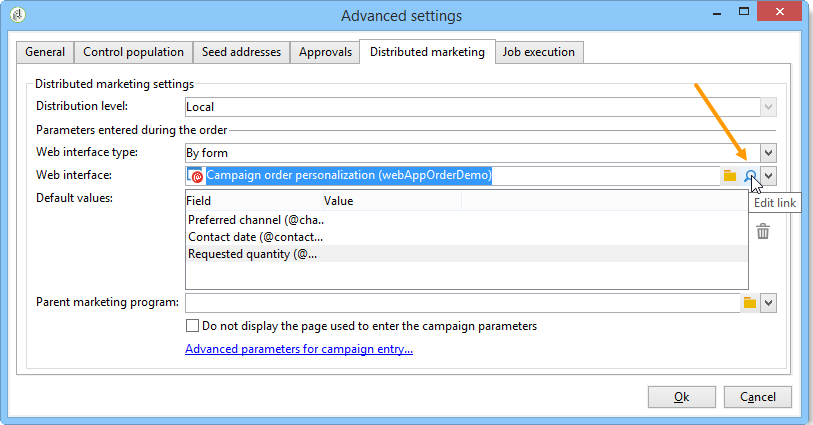

>[!NOTE]
>
>Web應用程式引數只能在行銷活動範本中使用。

在&#x200B;**[!UICONTROL Edit]**&#x200B;索引標籤中，選取&#x200B;**行銷活動訂單**&#x200B;活動並開啟以存取其內容。

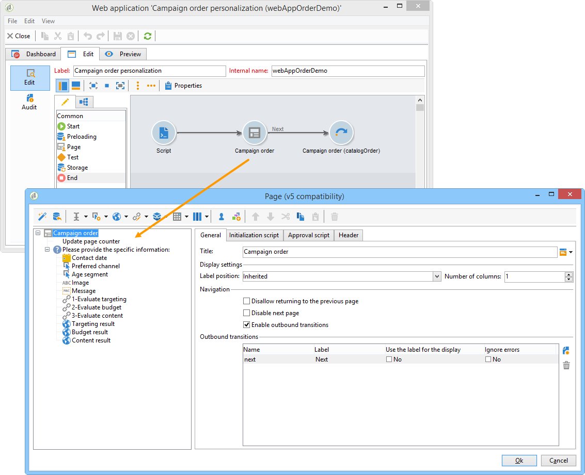

在此範例中，**行銷活動訂單**&#x200B;活動包括：

* 要由本地實體在訂單期間輸入的欄位，

  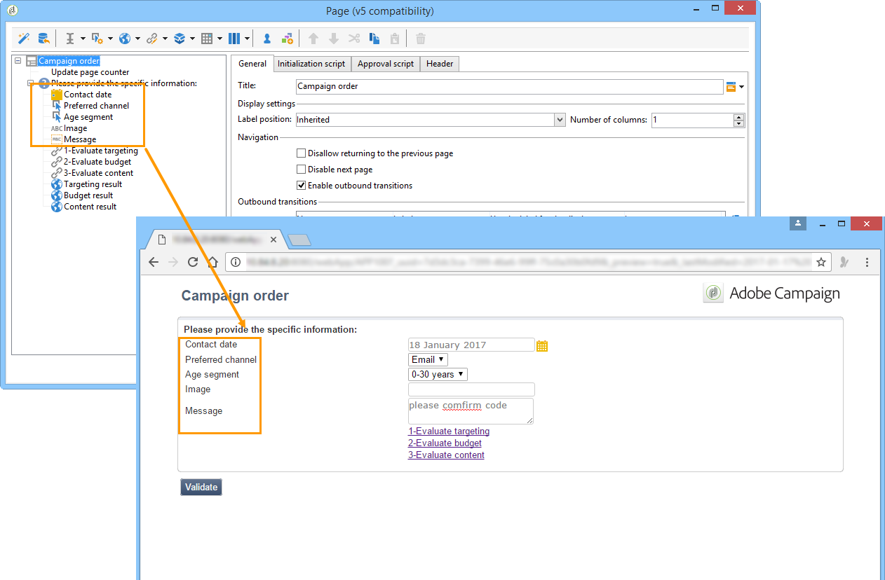

* 可讓本地實體評估行銷活動的連結（例如目標、預算、內容等），

  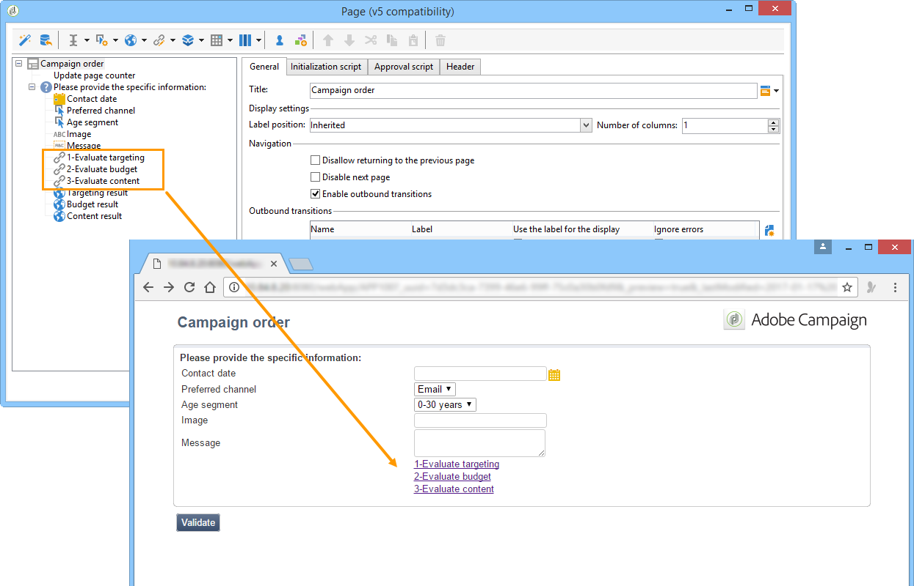

* 可讓您計算並顯示這些評估結果的指令碼。

  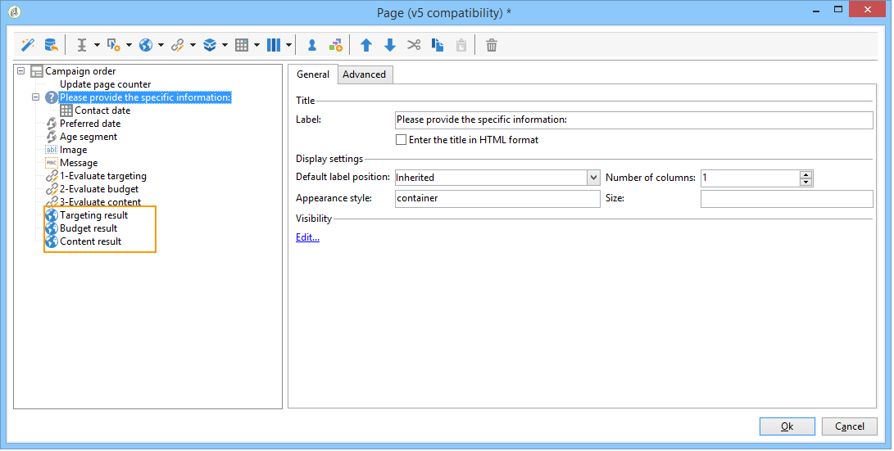

在此範例中，使用下列API：

* 對於目標評估，

  ```
  var res = nms.localOrder.EvaluateTarget(ctx.localOrder);
  ```

* 對於預算評估，

  ```
  var res = nms.localOrder.EvaluateDeliveryBudget(ctx.@deliveryId, NL.XTK.parseNumber(ctx.@compt));
  ```

* 對於內容評估，

  ```
  var res = nms.localOrder.EvaluateContent(ctx.localOrder, ctx.@deliveryId, "html", resSeed.@id);
  ```

## 建立合作行銷活動（依目標核准） {#creating-a-collaborative-campaign--by-target-approval-}

### 簡介 {#introduction}

您是一家大型服裝品牌的行銷經理，該品牌在美國各地擁有一家線上商店和幾家精品店。 春天到了，您決定建立特別優惠方案，將給予最佳客戶目錄中所有裙子50%的優惠。

此優惠方案主要針對您美國店舖的最佳客戶，也就是說自今年初以來已花費超過$300的客戶。

因此，您決定使用分散式行銷來建立合作行銷活動（依目標核准），這可讓您選取商店的最佳客戶（依區域分組），這些客戶將收到包含特殊優惠方案的電子郵件傳遞。

此範例的第一部分說明接收行銷活動建立通知的本地實體，以及如何使用它來評估行銷活動並進行訂購。

此範例的第二部分說明如何建立您的行銷活動。

步驟如下：

本機實體的&#x200B;****

1. 使用行銷活動建立通知來存取中央實體選取的聯絡人清單。
1. Select聯絡人並核准參與率。

中央實體的&#x200B;**：**

1. 建立&#x200B;**[!UICONTROL Data distribution]**&#x200B;活動。
1. 建立合作行銷活動。
1. 發佈行銷活動。

### 本機實體側 {#local-entity-side}

1. 已選擇參與行銷活動的本機實體將會收到電子郵件通知。

   ![目標核准電子郵件包含[存取您的連絡人清單並核准目標定位連結]。](assets/mkg_dist_use_case_target_valid8.png)

1. 按一下&#x200B;**[!UICONTROL Access your contact list and approve targeting]**&#x200B;連結，即可授予本機實體存取為行銷活動選取之使用者端清單的許可權（透過網頁瀏覽器）。

   

1. 本機實體會從清單中取消檢查某些連絡人，因為自年初以來，已就類似的選件與他們聯絡。

   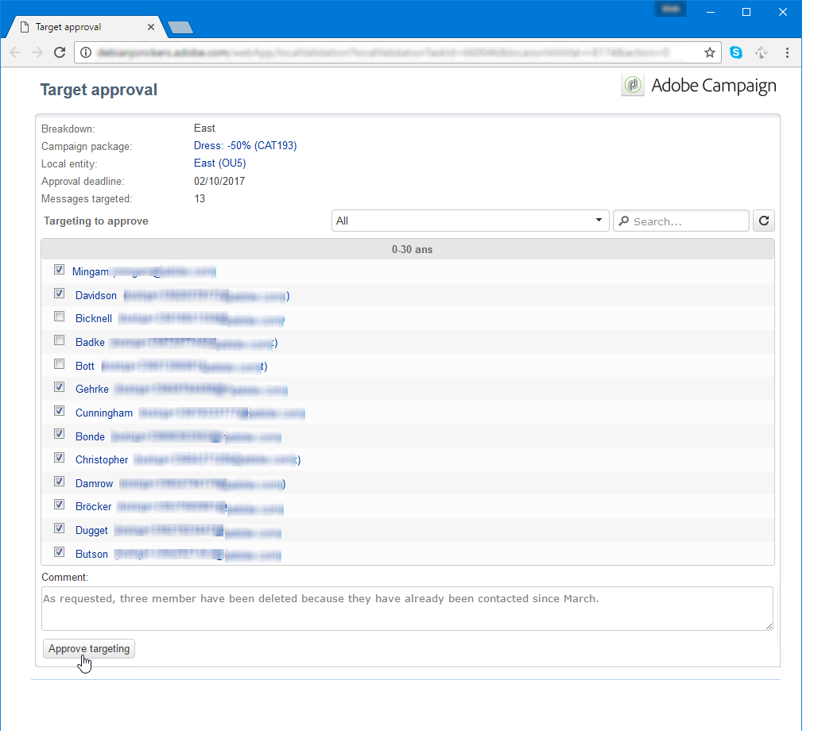

檢查通過後，行銷活動就會自動開始。

### 中央實體側 {#central-entity-side}

#### 建立資料發佈活動 {#creating-a-data-distribution-activity}

1. 若要設定合作行銷活動（依目標核准），您必須先建立&#x200B;**[!UICONTROL Data distribution activity]**。 按一下Campaign Explorer **[!UICONTROL Resources > Campaign management > Data distribution]**&#x200B;資料夾中的&#x200B;**[!UICONTROL New]**&#x200B;圖示。

   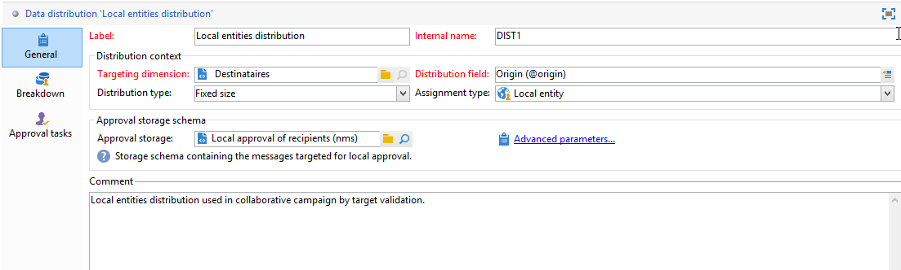

1. 在&#x200B;**[!UICONTROL General]**&#x200B;索引標籤中，您必須指定：

   * **[!UICONTROL Targeting dimension]**。 在此對&#x200B;**收件者**&#x200B;執行&#x200B;**資料發佈**。
   * **[!UICONTROL Distribution type]**。 您可以選擇&#x200B;**固定大小**&#x200B;或&#x200B;**大小作為百分比**。
   * **[!UICONTROL Assignment type]**。 Select **本機實體**&#x200B;選項。
   * **[!UICONTROL Distribution type]**。 在這裡，是存在於收件者表格中的&#x200B;**[!UICONTROL Origin (@origin)]**&#x200B;欄位，可讓您識別連絡人與本機實體之間的關係。
   * **[!UICONTROL Approval storage]**&#x200B;欄位。 Select **本機核准收件者**&#x200B;選項。

1. 在&#x200B;**[!UICONTROL Breakdown]**&#x200B;索引標籤中，指定：

   * **[!UICONTROL Distribution field value]**，對應於即將推出的行銷活動中涉及的本機實體。
   * 本機實體&#x200B;**[!UICONTROL label]**。
   * **[!UICONTROL Size]** （固定或以百分比表示）。 **0預設值**&#x200B;包含選取連結至本機實體的所有收件者。

   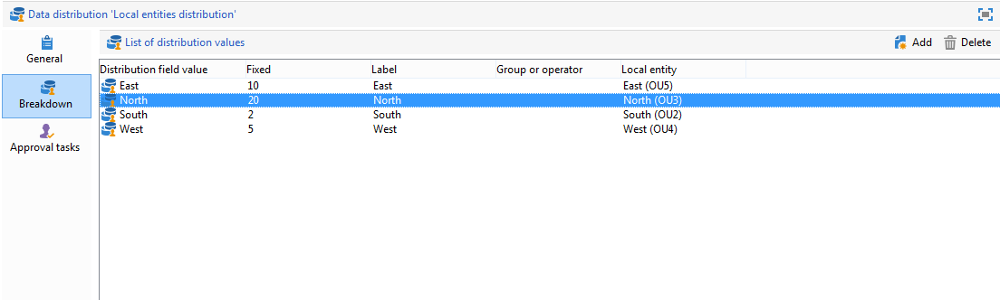

1. 儲存您的新資料分佈。

#### 建立協作行銷活動 {#creating-a-collaborative-campaign}

1. 從Campaign Explorer的&#x200B;**[!UICONTROL Campaign management > Campaign]**&#x200B;資料夾建立新的&#x200B;**[!UICONTROL collaborative campaign (by target approval)]**。
1. 在&#x200B;**[!UICONTROL Targeting and workflows]**&#x200B;索引標籤中，為您的行銷活動建立工作流程。 這必須包含由&#x200B;**[!UICONTROL Data distribution]**&#x200B;活動定義&#x200B;**[!UICONTROL Record count limitation]**&#x200B;的&#x200B;**分割**&#x200B;活動。

   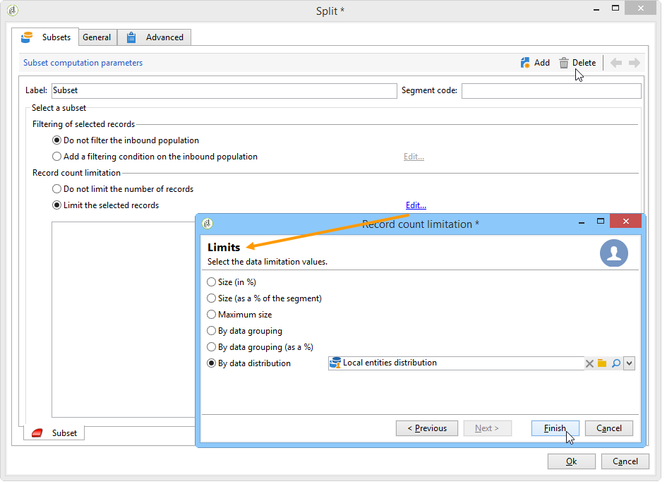

1. 新增&#x200B;**[!UICONTROL Local approval]**&#x200B;動作，您可以在其中指定：

   * 將在通知中傳送給本機實體的訊息內容，
   * 核准提醒，
   * 行銷活動的預期處理。

   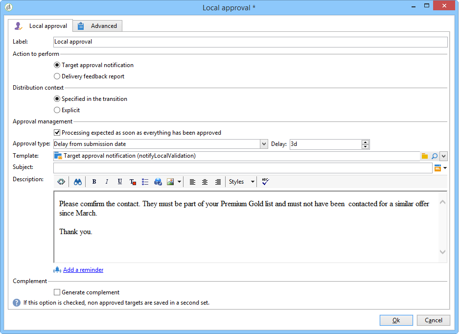

1. 儲存您的記錄。

#### 發佈行銷活動 {#publishing-the-campaign}

您現在可以從&#x200B;**[!UICONTROL Campaigns]**&#x200B;索引標籤新增&#x200B;**行銷活動套件**。

1. 選擇您的&#x200B;**[!UICONTROL Reference campaign]**。 在封裝的&#x200B;**[!UICONTROL Edit]**&#x200B;標籤中，您可以選取要用於行銷活動的&#x200B;**[!UICONTROL Approval mode]**：

   * 在&#x200B;**手動**&#x200B;模式中，如果本機實體接受來自中央實體的邀請，則會參與行銷活動。 如果他們想要且需要經理的核准以確認其參與促銷活動，則可以刪除預先選取的聯絡人。
   * 在&#x200B;**自動**&#x200B;模式中，本機實體必須參與行銷活動，除非他們從行銷活動取消註冊。 他們不需要核准就可以刪除連絡人。

   ![具有參考行銷活動且核准模式欄位設定為[手動]的行銷活動套件建立對話方塊。](assets/mkg_dist_use_case_target_valid.png)

1. 在&#x200B;**[!UICONTROL Description]**&#x200B;索引標籤中，您可以新增行銷活動的說明，以及要傳送給本機實體的任何檔案。

   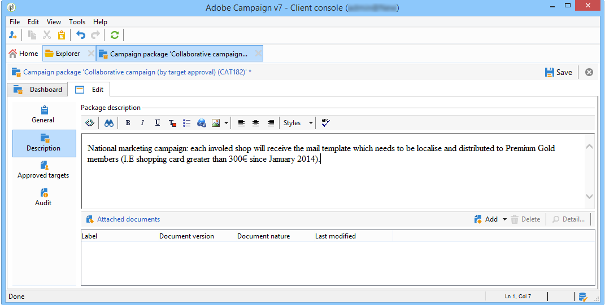

1. 核准您的行銷活動套件，然後啟動您的工作流程以發佈套件，並讓它可用於套件清單中的所有本機實體。

   ![具有[核准封裝]按鈕的封裝儀表板，顯示正在編輯的狀態。](assets/mkg_dist_use_case_target_valid2.png)

## 建立合作行銷活動（依表單） {#creating-a-collaborative-campaign--by-form-}

### 簡介 {#introduction-1}

您是一家大型化妝品牌的行銷經理，該品牌在美國各地擁有一家線上商店和幾家精品店。 為了卸除冬季庫存，並為新庫存騰出空間，您決定建立特別優惠方案，以兩種客戶類別為目標：30歲以上的客戶，您將向其提供年齡敏感的護膚產品；以及30歲以下的客戶，您將向其提供更基本的護膚產品。

因此，您決定使用分散式行銷來建立合作行銷活動（依表單），可讓您依年齡範圍從不同的商店選取客戶。 這些客戶將收到電子郵件傳遞，內含已根據其年齡範圍進行個人化的特殊優惠。

此範例的第一部分說明接收行銷活動建立通知的本地實體，以及如何使用它來評估行銷活動並進行訂購。

此範例的第二部分說明如何建立您的行銷活動。

步驟如下：

本機實體的&#x200B;****

1. 使用行銷活動建立通知來存取線上表單。
1. 個人化行銷活動（目標、內容、傳遞量）。
1. 檢查這些欄位，並視需要加以變更。
1. 核准您的參與。
1. 本機實體（或中央實體）的管理員會核准您的設定和參與。

中央實體的&#x200B;**：**

1. 建立合作行銷活動。
1. 設定&#x200B;**[!UICONTROL Advanced campaign parameters...]**，就像您在本機行銷活動中的設定一樣。
1. 設定行銷活動工作流程和傳送，就像您設定本機行銷活動一樣。
1. 更新網路表單。
1. 建立行銷活動套件並發佈。

### 本機實體側 {#local-entity-side-1}

1. 選取要參與行銷活動的本地實體會收到電子郵件通知，通知他們已參與行銷活動。

   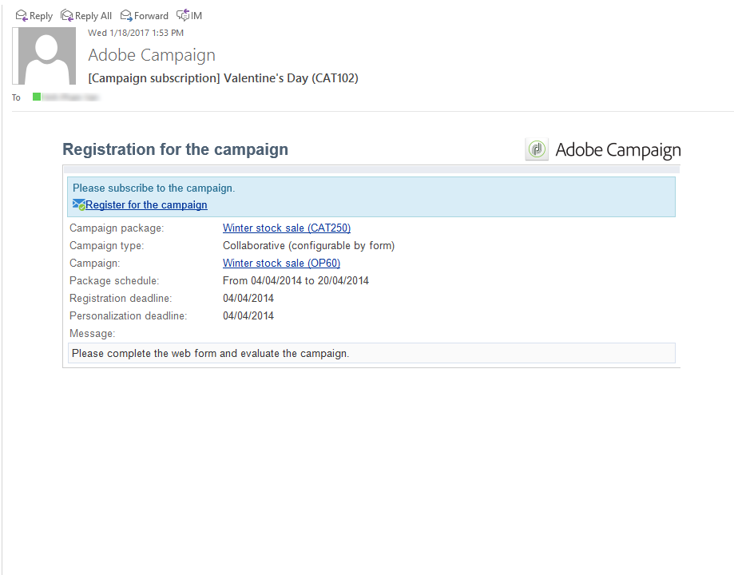

1. 本機實體完成個人化表單，然後他們：

   * 評估目標和預算，
   * 預覽傳遞內容，
   * 核准其參與率。

     ![含有評估連結、影像預覽和[驗證]按鈕的Campaign訂單Web表單。](assets/mkg_dist_use_case_form_8.png)

1. 負責驗證訂單的操作員核准其參與。

   ![含有訂單詳細資料、訂單註解及[驗證]按鈕的行銷活動訂單核准頁面。](assets/mkg_dist_use_case_form_9.png)

### 中央實體側 {#central-entity-side-1}

1. 若要實作合作行銷活動（依表單），您必須使用&#x200B;**合作行銷活動（依表單）**&#x200B;範本建立行銷活動。

   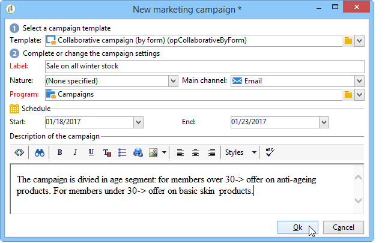

1. 在促銷活動的&#x200B;**[!UICONTROL Edit]**&#x200B;索引標籤中，按一下&#x200B;**[!UICONTROL Advanced campaign parameters...]**&#x200B;連結以將其設定為本機促銷活動。 請參閱[建立本機行銷活動（依表單）](#creating-a-local-campaign--by-form-)。

   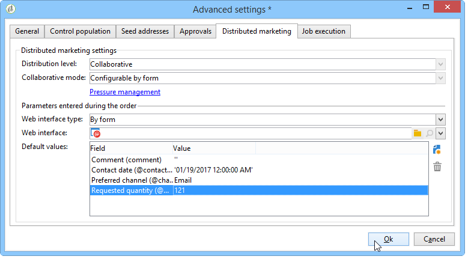

1. 設定行銷活動工作流程與網頁表單。 請參閱[建立本機行銷活動（依表單）](#creating-a-local-campaign--by-form-)。
1. 指定執行排程和相關本機實體，以建立您的Campaign套件。

   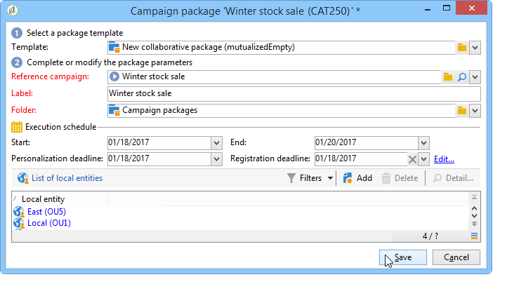

1. 在&#x200B;**[!UICONTROL Edit]**&#x200B;索引標籤中選取核准模式，以完成封裝設定。

   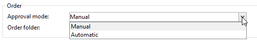

1. 從「**[!UICONTROL Description]**」索引標籤，您可以輸入行銷活動套件說明、發佈套件時傳送給本機實體的通知訊息，以及附加任何資訊性檔案至行銷活動套件。

   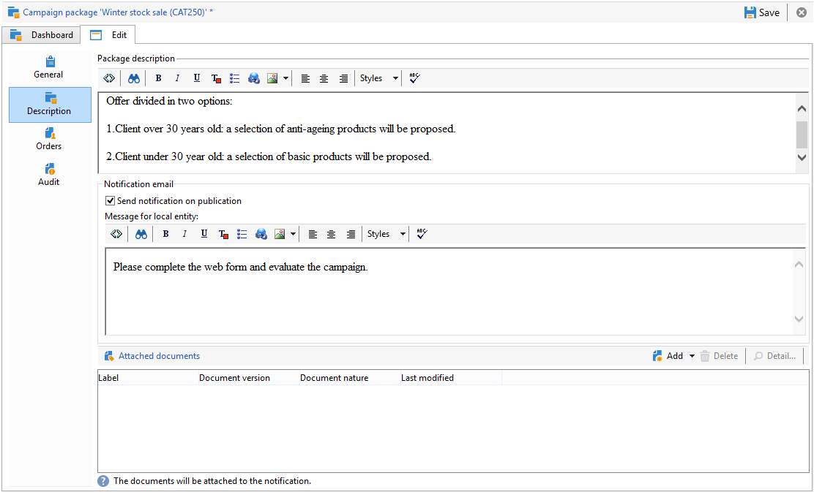

1. 核准套件以發佈。

   ![核准封裝按鈕開啟封裝上的動作對話方塊，其中包含[接受]和[拒絕]選項。](assets/mkg_dist_use_case_form_6.png)
