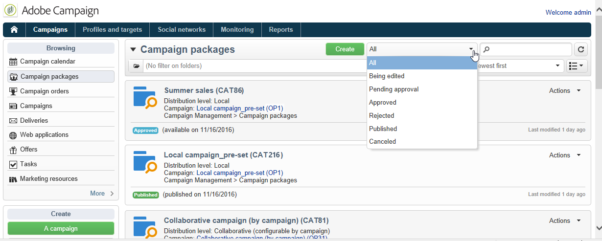
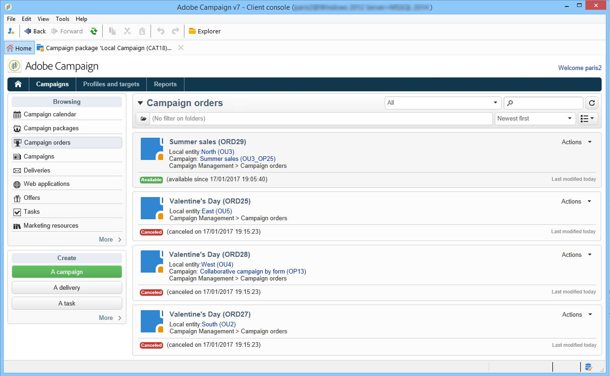
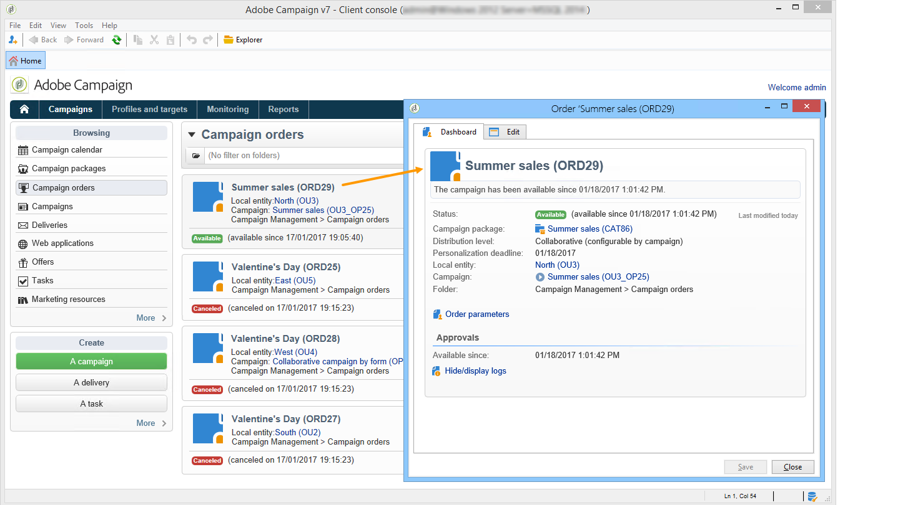
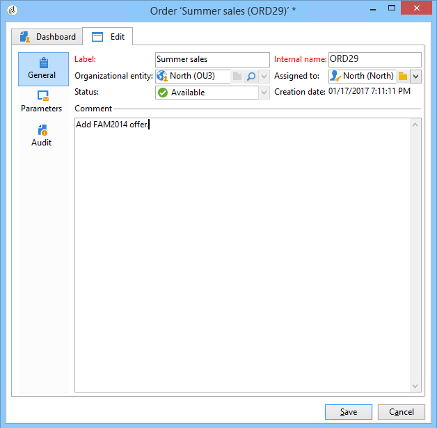
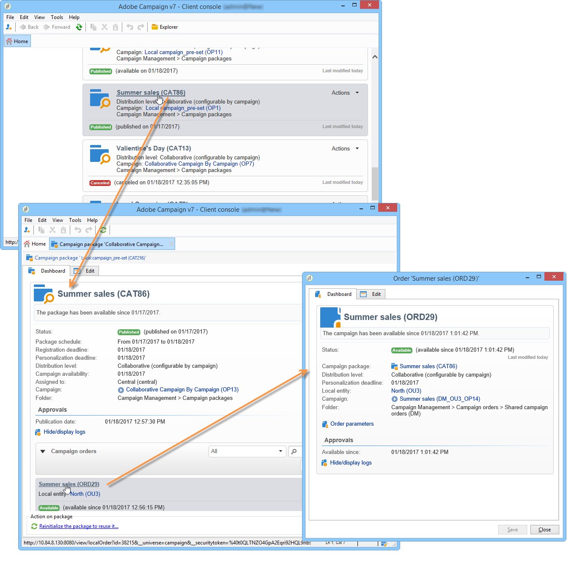
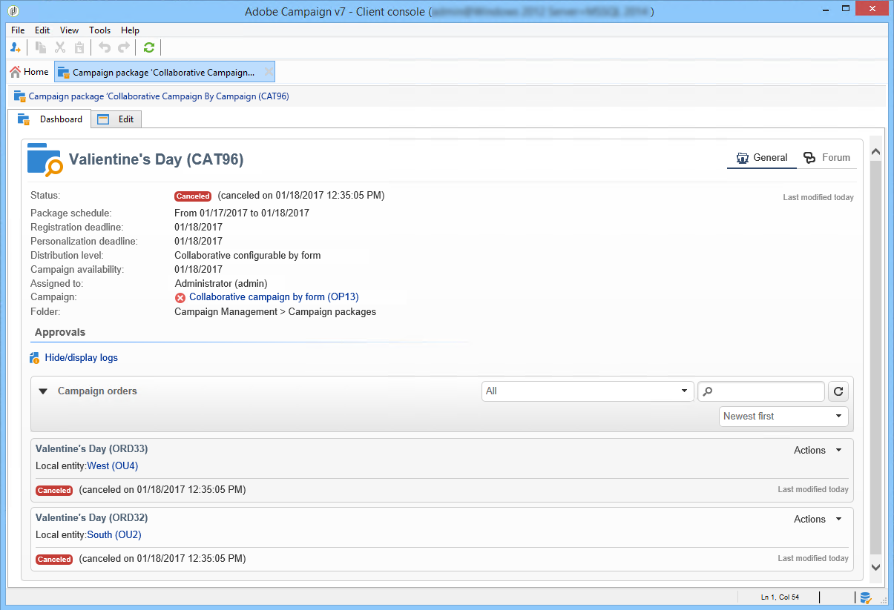
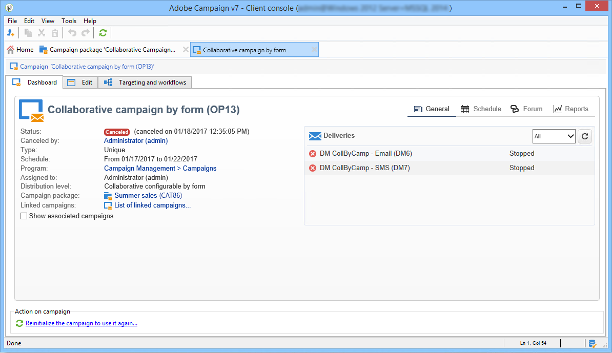
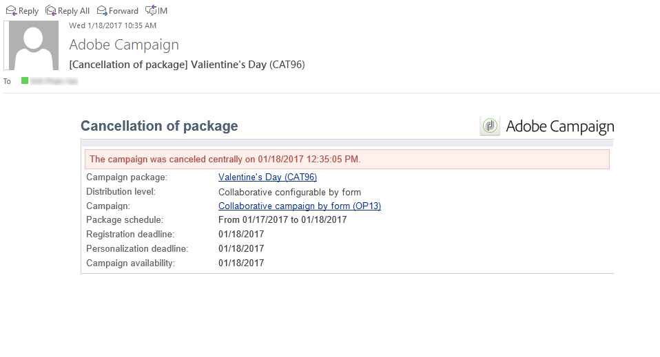

# 追蹤行銷活動{#tracking-a-campaign}

中央實體運運算元可追蹤行銷活動套件清單中的行銷活動訂單。

如此可讓他們：

* [篩選封裝](#filter-packages)，
* [編輯封裝](#edit-packages)，
* [取消封裝](#cancel-a-package)，
* [重新初始化封裝](#reinitializing-a-package)。

## 篩選封裝 {#filter-packages}

從「**[!UICONTROL Campaigns]**」索引標籤，您可以顯示&#x200B;**[!UICONTROL Campaign packages]**&#x200B;的清單，其會重新分組所有現有的分散式行銷活動。 您可以篩選此清單，使其僅顯示已發佈、延遲、未決核准等行銷活動。若要這麼做，請按一下此檢視上方區段中的連結，或使用&#x200B;**[!UICONTROL Filter list]**&#x200B;連結並選取要顯示的行銷活動套件狀態。

## 編輯套裝 {#edit-packages}

**[!UICONTROL Campaign packages]**&#x200B;頁面可讓您檢視每個套件的摘要。

此摘要會顯示下列資訊：標籤、行銷活動型別，以及從中建立行銷活動的名稱和資料夾。

按一下封裝名稱以進行編輯。 您也可以依其本機實體及其狀態來檢視訂單。

列出所有訂單的&#x200B;**[!UICONTROL Campaign orders]**&#x200B;檢視中也提供此資訊。

中央運運算元可以編輯順序。 有兩種方法可以達成此目的：

1. 運運算元可以按一下訂單名稱來進行編輯：這會顯示訂單詳細資料。

   

   **[!UICONTROL Edit > General]**&#x200B;索引標籤可讓您檢視本機實體在訂購行銷活動時輸入的資訊。

   

1. 操作員可以按一下行銷活動套件標籤以進行編輯並變更某些設定。

   

## 取消套裝 {#cancel-a-package}

中央實體可隨時取消行銷活動套件。

按一下行銷活動套件&#x200B;**[!UICONTROL Dashboard]**&#x200B;中的&#x200B;**[!UICONTROL Cancel]**。

![取消封裝儀表板上的封裝按鈕會開啟封裝上的動作對話方塊，其中包含[註解]欄位。](assets/mkg_dist_cancel_op_from_dashboard.png)

**[!UICONTROL Comment]**&#x200B;欄位可讓您調整取消。

對於&#x200B;**本機行銷活動**，取消套件會將其從可用的行銷活動清單中移除。

對於&#x200B;**合作行銷活動**，取消套件會觸發許多動作：

1. 與此封裝相關的任何訂單都會被取消，

   

1. 參考行銷活動已取消，且所有作用中的流程（工作流程、傳送）都會停止。

   

1. 會傳送通知給所有相關本機實體。

   

如有必要，中央實體仍可存取及重新初始化已取消的套件（請參閱下文）。 只有當本機實體核准並開始使用它們時，才會再次提供它們。 封裝重新初始化程式如下所示。

## 重新初始化封裝 {#reinitializing-a-package}

已發佈的行銷活動套件可以重新初始化、修改，並供本機實體使用。

1. 相關的套件Select。
1. 按一下&#x200B;**[!UICONTROL Reinitialize the package to reuse it]**&#x200B;連結，然後按一下&#x200B;**[!UICONTROL OK]**。

   ![重新初始化封裝確認對話方塊：狀態變成[正在編輯]，使用[確定]按鈕。](assets/mkg_dist_mutual_op_reinit.png)

1. 按一下&#x200B;**[!UICONTROL Save]**&#x200B;按鈕以核准封裝重新初始化。

   ![已取消封裝儀表板，並反白顯示[儲存]按鈕以核准重新初始化。](assets/mkg_dist_mutual_op_reinit2.png)

1. 封裝狀態變更為&#x200B;**[!UICONTROL Being edited]**。 再次修改、核准並發佈，以將其還原至行銷活動套件清單。

>[!NOTE]
>
>您也可以重新初始化已取消的行銷活動套件。
