# 假設範本{#hypothesis-templates}

## 建立假設模型 {#creating-a-hypothesis-model}

設定假設範本可讓您定義測量回應的內容，無論是傳送或選件。 這是參照各種測量表格的位置，包括定義個人、假設和交易表之間關係的測量表格。

若要建立假設範本，請套用下列步驟：

1. 在Adobe Campaign總管中，按一下&#x200B;**[!UICONTROL Resources>Templates>Hypothesis templates]**。

   ![總管已選取資源>範本>假設範本，且假設範本在[一般]索引標籤上開啟。](assets/response_hypothesis_model_creation_001.png)

1. 按一下&#x200B;**[!UICONTROL New]**&#x200B;或在範本清單中按一下滑鼠右鍵，然後在下拉式清單中選擇&#x200B;**[!UICONTROL New]**。
1. 輸入假設標籤。
1. 指定範本是預期要透過&#x200B;**[!UICONTROL Hypothesis type]**&#x200B;用於優惠或傳遞的假設。
1. 針對&#x200B;**[!UICONTROL Delivery]**&#x200B;型別範本，指定是否應在控制組內進行測量。 [了解更多](#properties-of-a-hypothesis-template)
1. 對於&#x200B;**[!UICONTROL Delivery]**&#x200B;型別範本，您可以使用&#x200B;**[!UICONTROL Channel]**&#x200B;下拉式清單來選擇特定管道，或決定將該範本套用至Adobe Campaign中的所有可用管道。 [了解更多](#properties-of-a-hypothesis-template)
1. Select您要在其中建立的&#x200B;**[!UICONTROL Execution folder]**，並自動執行將從此範本建立的假設。
1. 選擇執行設定。 [了解更多](#hypothesis-template-execution-settings)
1. 指定假設計算期間。 [了解更多](#hypothesis-template-execution-settings)

   >[!CAUTION]
   >
   >此期間由聯絡日期決定。

1. 在&#x200B;**[!UICONTROL Transactions]**&#x200B;索引標籤中，指定假設計算所需的資料表和欄位。 [了解更多](#transactions)
1. 如果您的範本設定為&#x200B;**[!UICONTROL Offer]**&#x200B;型別假設，您可以啟用&#x200B;**[!UICONTROL Update offer proposition status]**&#x200B;選項：在此情況下，請選取您要變更之優惠方案主張的狀態。
1. 指定假設應用程式的範圍。 [了解更多](#hypothesis-perimeter)
1. 如有必要，請使用指令碼完成篩選。 [了解更多](#hypothesis-perimeter)

### 假設範本的屬性 {#properties-of-a-hypothesis-template}

範本的&#x200B;**[!UICONTROL General]**&#x200B;標籤可讓您指定一般範本選項。 可用的欄位包括：

* **[!UICONTROL Hypothesis type]**：可讓您判斷範本是否應該預定給傳遞或優惠方案的假設。

  您也可以選擇建立將同時套用至傳送和優惠方案的假設。

  >[!NOTE]
  >
  >如果範本套用至選件，**[!UICONTROL Transactions]**&#x200B;索引標籤中會提供&#x200B;**[!UICONTROL Update offer proposition status]**&#x200B;選項。

* **[!UICONTROL Measurement with control group]**：可讓您指出是否已為傳遞或行銷活動定義控制組，並將其納入測量指標中。 控制組不會接收傳遞，可讓您透過比較行銷活動與收到傳遞的目標母體，來測量傳遞後行銷活動的影響。

  >[!NOTE]
  >
  >如果範本設定為將控制組列入考量，但在假設相關的傳送中未定義任何組，則結果將僅以目標收件者為基礎。

  有關定義和設定控制組的詳細資訊，請參閱[Campaign v8檔案](https://experienceleague.adobe.com/docs/campaign/automation/campaign-orchestration/marketing-campaign-target.html?lang=zh-Hant#add-a-control-group){target=_blank}。

* **[!UICONTROL Channel]**：您可以在下拉式清單中選取&#x200B;**[!UICONTROL All channels]**，以選擇特定管道或讓假設範本可供Adobe Campaign主控台中的所有管道使用。 如果您設定特定頻道的範本，這可讓您在建立假設時自動篩選每個頻道的傳送。 [了解更多](creating-hypotheses.md)

  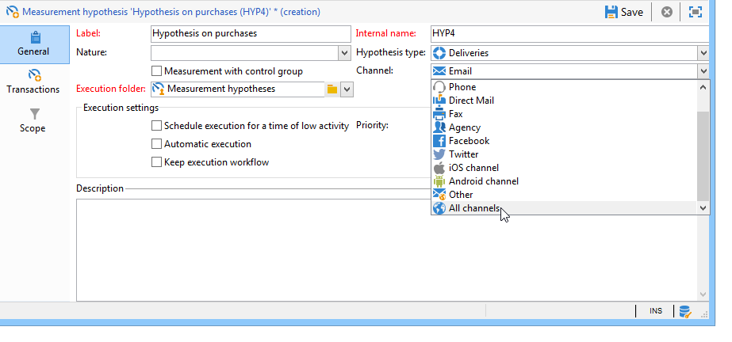

* **[!UICONTROL Execution folder]**：可讓您指定假設的執行資料夾。
* **[!UICONTROL Taken into account in campaign ROI calculation]**：在相關行銷活動的ROI計算中，將假設結果納入考量。

### 假設範本執行設定 {#hypothesis-template-execution-settings}

範本的&#x200B;**[!UICONTROL General]**&#x200B;標籤也可讓您指定假設執行引數。 可用的選項如下：

* **[!UICONTROL Schedule execution for a time of low activity]**：可讓您排程假設啟動，以最佳化Adobe Campaign效能。 核取此選項時，行銷活動的處理工作流程會在停機期間執行假設計算。

  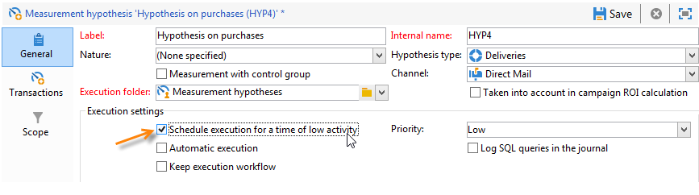

* **[!UICONTROL Priority]**：套用至假設的層級，在有同時執行的情況下將假設計算順序隔開。

  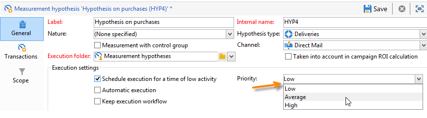

* **[!UICONTROL Automatic execution]**：如有必要，可讓您排程假設重新計算（例如，如果您要定期更新指標直到傳送結束）。

  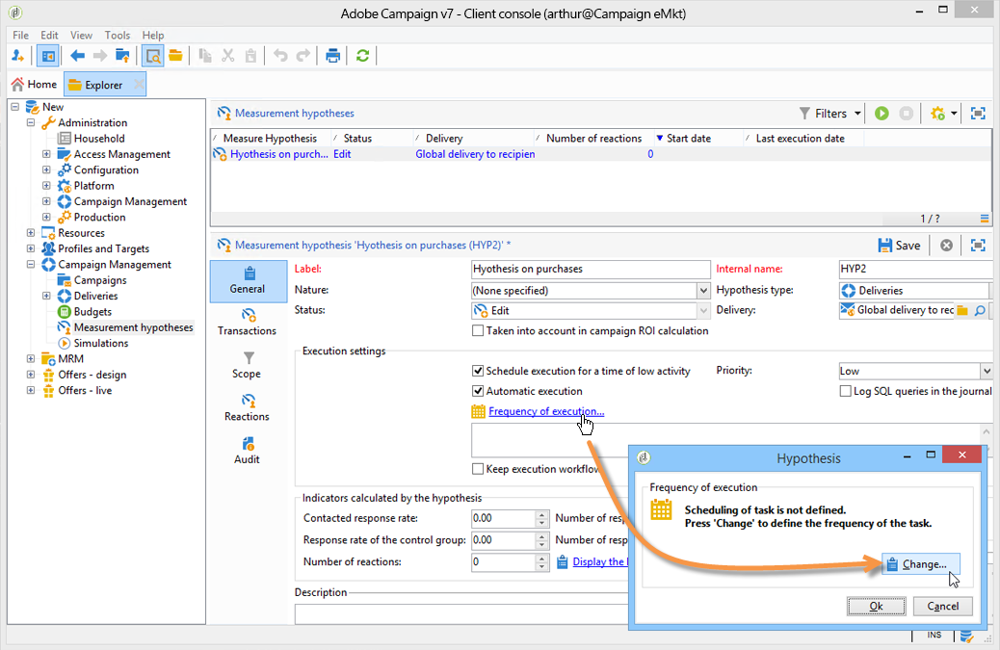

  若要指定排程，請套用下列程式：

  1. 按一下&#x200B;**[!UICONTROL Frequency of execution...]**&#x200B;連結，然後按&#x200B;**[!UICONTROL Change...]**&#x200B;按鈕。

     ![說明未定義任務排程的假設對話方塊，使用[變更]按鈕來定義頻率。](assets/response_frequency_execution_001.png)

  1. 設定頻率、相關事件和有效期。

     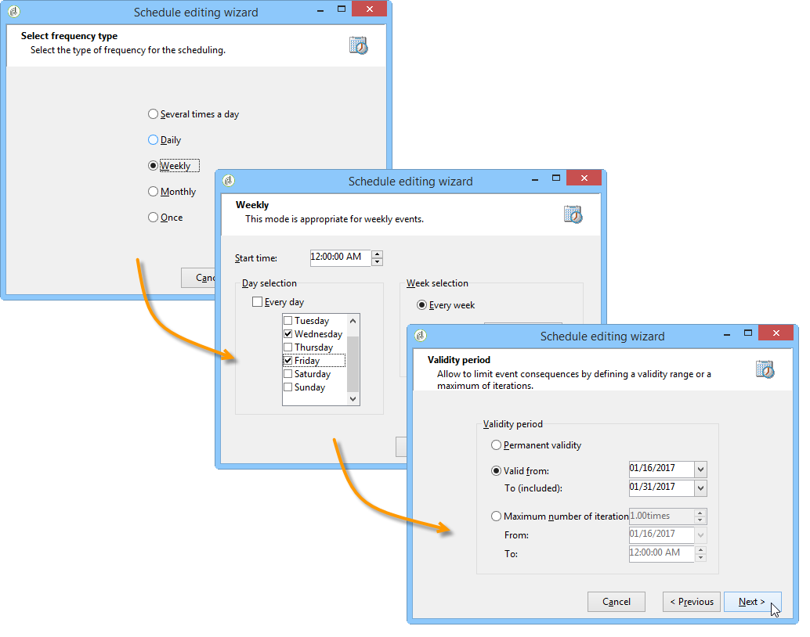

  1. 按一下&#x200B;**[!UICONTROL Finish]**&#x200B;以儲存排程。

     ![使用[完成]按鈕排程編輯精靈摘要步驟列出啟動時間。](assets/response_frequency_execution_003.png)

* **[!UICONTROL Log SQL queries in journal]**：此函式已保留給專家使用者。 它可讓您在測量假設稽核中新增索引標籤，以顯示SQL查詢。 如此一來，在模擬完成時若發生錯誤，即可偵測可能的故障。
* **[!UICONTROL Keep execution workflow]**：可讓您保留假設計算開始時自動產生的工作流程。 在從已核取此選項的範本建立的假設中，產生的工作流程可用於遵循該流程。

  >[!CAUTION]
  >
  >此選項僅能用於偵錯，以防執行假設時發生錯誤。\
  >此外，不得修改自動產生的工作流程。 在之後的計算中，任何最終修改都不會在其他地方被考慮。\
  >如果您已核取此選項，請在工作流程執行後將其刪除。

### 交易數 {#transactions}

此索引標籤包含各種欄位和表格，可讓您根據交易儲存收件者回應的歷史記錄。 請參閱此[區段](https://experienceleague.adobe.com/zh-hant/docs/campaign-classic/using/configuring-campaign-classic/schema-reference/about-schema-reference){target="_blank"}，以取得回應管理專用表格的詳細資訊。

* **[!UICONTROL Schema (reaction log storage)]**：選取收件者回應表格。 Adobe Campaign中的現成表格是&#x200B;**NmsRemaMatchRcp**。
* **[!UICONTROL Transaction schema]**：選擇假設所關注的資料表，即交易或購買資料表。
* **[!UICONTROL Querying schema]**：選擇篩選假設的條件。
* **[!UICONTROL Link to individuals]**：選擇個人與做為交易結構描述之資料表之間的連結。
* **[!UICONTROL Link to the household]**：如果您想要在假設中納入某個家庭的所有成員，請選取交易結構描述中該家庭的連結。 此欄位為選用。
* **[!UICONTROL Transaction date]**：此欄位是選用欄位，但建議使用，因為它可讓您定義假設計算的範圍。
* **[!UICONTROL Measurement period]**：可讓您設定執行假設與復原購買明細行的開始與結束日期。

  當假設連結至傳遞時，對於直接郵件傳遞，測量會在聯絡日期後數天自動觸發，對於電子郵件或簡訊傳遞，則會在傳遞日期後自動觸發。

  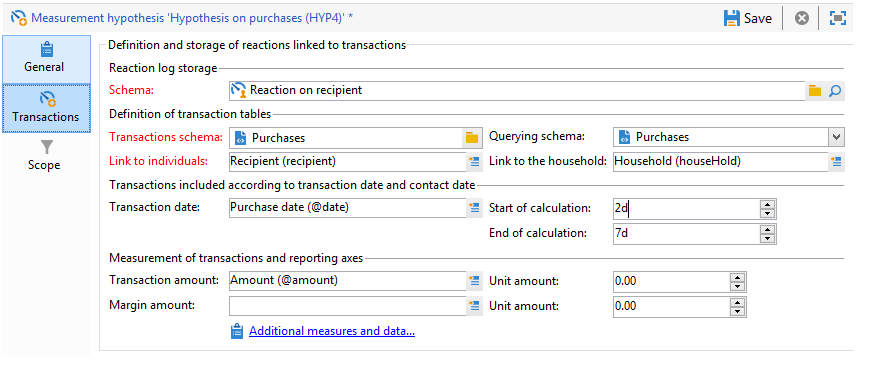

  如果立即啟動假設，且想要立即觸發，則可強制啟動。 否則，會根據設定的計算結束日期（以假設建立日期為基礎）自動觸發。 [深入瞭解](creating-hypotheses.md#creating-a-hypothesis-on-the-fly-on-a-delivery))。

* **[!UICONTROL Transaction/Margin amount]**：這些欄位是選用欄位，可讓您自動計算人員調整指標。 [了解更多](hypothesis-tracking.md#indicators)
* **[!UICONTROL Unit amount]**：可讓您設定計算收入的金額。 [了解更多](hypothesis-tracking.md#indicators)

  ![交易索引標籤，其[交易金額]設定為@amount，且箭頭指向[單位金額]欄位。](assets/response_transactions_001.png)

* **[!UICONTROL Additional measures and data]**：可讓您從不同表格中的欄位指定其他報表測量或軸。
* **[!UICONTROL Update offer proposition status]**：可讓您變更優惠方案主張的狀態（如果假設已識別優惠方案收件者）。

  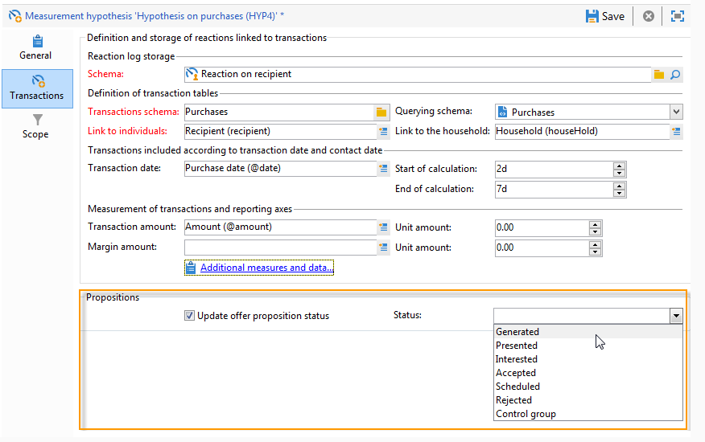

### 假設周邊 {#hypothesis-perimeter}

定義交易表格和假設將關注的欄位後，您可以使用篩選器指定目標交易和傳送，以縮小假設的範圍。 您也可以使用JavaScript指令碼，明確指向交易表格中所參照的產品。

* **篩選交易**：在&#x200B;**[!UICONTROL Scope]**&#x200B;索引標籤中，您可以設定假設的篩選器。 操作步驟：

  1. 按一下&#x200B;**[!UICONTROL Edit query]**&#x200B;連結。

     ![範圍索引標籤，在[篩選連結至回應的交易]下有[編輯查詢]連結。](assets/response_scope_filtering_001.png)

  1. 指定您的篩選條件。

     ![編輯查詢精靈：篩選選取的條件，然後按一下[編輯運算式]按鈕與欄位選取樹狀結構。](assets/response_scope_filtering_002.png)

  1. Select假設將關注的交易。

     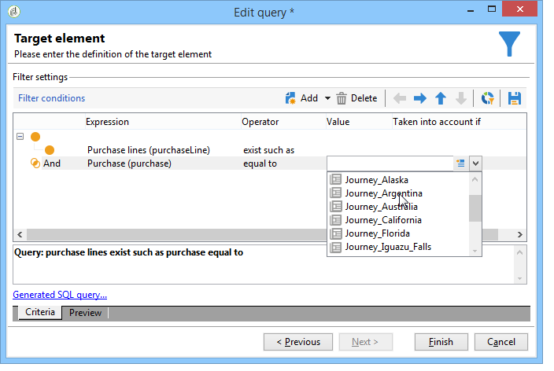

* **篩選收件者**：在&#x200B;**[!UICONTROL Scope]**&#x200B;索引標籤中，您可以將假設限製為連結至郵件的任何資訊（傳遞、收件者、電子郵件地址、服務等）：

  1. 按一下&#x200B;**[!UICONTROL Add a filter]**&#x200B;連結，然後按&#x200B;**[!UICONTROL Edit query]**。

     ![範圍索引標籤，其中的[新增篩選器]連結與[編輯查詢]連結位於[篩選傳遞訊息]下。](assets/response_scope_filtering_004.png)

  1. 指定您的篩選條件。

     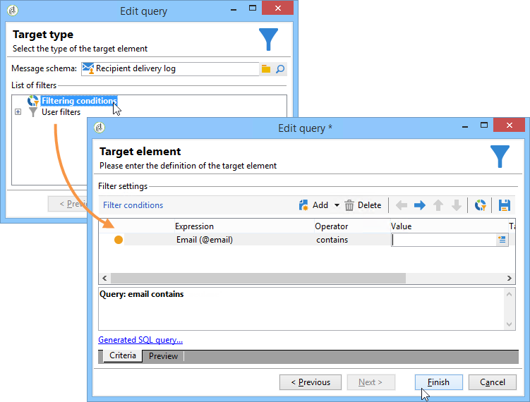

  1. 按一下&#x200B;**[!UICONTROL Finish]**&#x200B;以儲存查詢。

     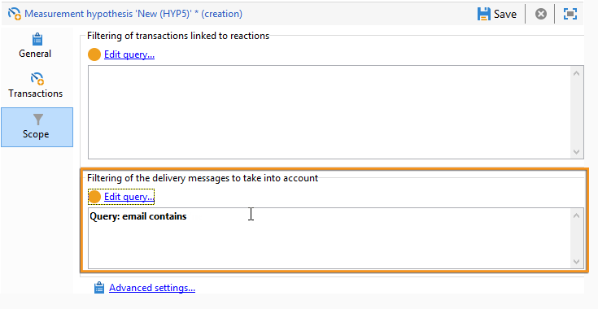

* **指令碼**：您可以使用JavaScript指令碼，在執行期間動態多載假設設定。

  若要這麼做，請按一下&#x200B;**[!UICONTROL Advanced settings]**&#x200B;連結，然後輸入所需的指令碼。

  >[!NOTE]
  >
  >此選項適用於專家使用者。

  ![進階設定對話方塊，已輸入初始化指令碼，從[範圍]索引標籤上的[進階設定]連結開啟。](assets/response_hypothesis_model_creation_011.png)

## 範例：在傳遞上建立假設範本 {#example--creating-a-hypothesis-template-on-a-delivery}

在此範例中，我們將針對直接郵件型別傳遞建立假設範本。 假設所依據的交易表（**購買**）包含連結至文章或產品的購買明細行。 我們想要設定模型，以建立購買表格中文章或產品的假設。

1. 在Adobe Campaign總管中，前往&#x200B;**[!UICONTROL Resources > Templates > Hypothesis templates]**&#x200B;節點。
1. 按一下&#x200B;**[!UICONTROL New]**&#x200B;以建立範本。

   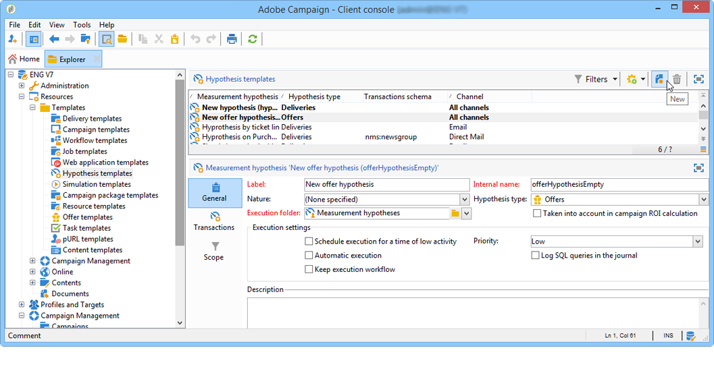

1. 變更範本標籤。

   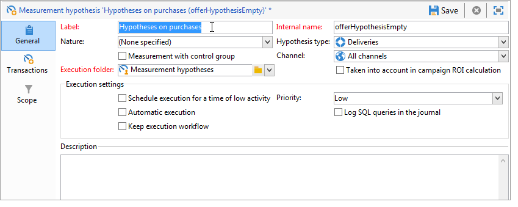

1. Select **[!UICONTROL Deliveries]**&#x200B;為假設型別。
1. 核取相關方塊，指定傳遞可包含控制組。
1. 選擇&#x200B;**[!UICONTROL Direct mail]**&#x200B;管道。

   >[!NOTE]
   >
   >由於範本是直接郵件傳遞所專屬，因此使用此模型建立的假設可能不會連結至任何其他傳遞型別。

1. 在&#x200B;**[!UICONTROL Transactions]**&#x200B;索引標籤中，選取收件者回應表格。

   ![使用Select的[結構描述]對話方塊的[交易]索引標籤，以及選取的收件者結構描述回應。](assets/response_hypothesis_model_example_006.png)

1. 在&#x200B;**[!UICONTROL Transactions schema]**&#x200B;欄位中，選擇您的購買表格。

   ![使用Select的[交易]索引標籤為檔案對話方塊，已針對選取的購買和購買進行篩選。](assets/response_hypothesis_model_example_007.png)

1. **[!UICONTROL Querying schema]**&#x200B;欄位中的Select購買明細行。

   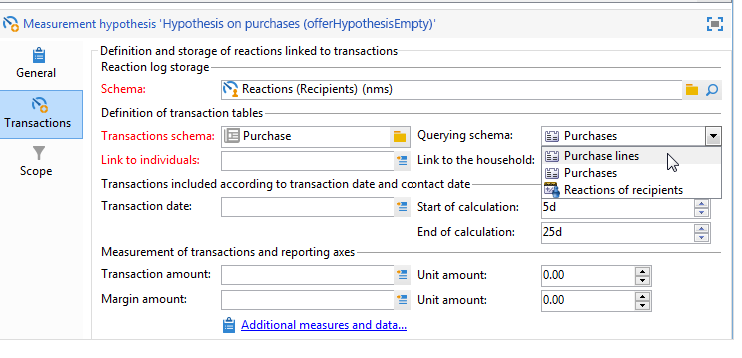

1. 選擇連結至購買表格的收件者。

   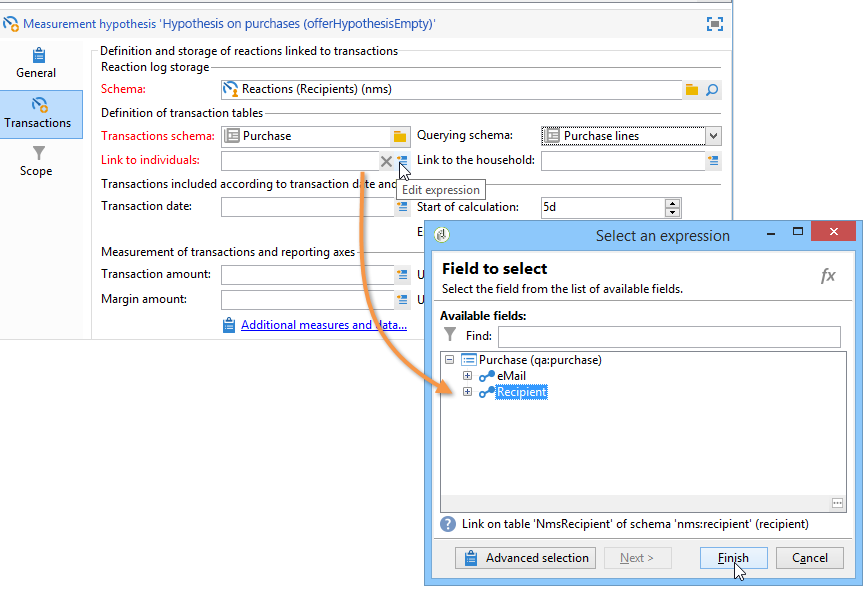

1. Select連結至購買日期的欄位。

   這可讓您定義假設的時間範圍。 此階段並非強制性，但建議使用。

   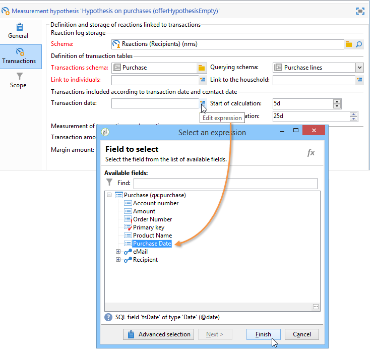

1. 設定計算期間5至25天。

   ![計算開始設為5d且計算結束設為25d的[交易]索引標籤。](assets/response_hypothesis_model_example_005.png)

1. 在&#x200B;**[!UICONTROL Scope]**&#x200B;索引標籤中，按一下&#x200B;**[!UICONTROL Edit query]**&#x200B;以建立假設的篩選器。

   ![已按一下[編輯查詢]的[範圍]索引標籤，且[編輯查詢]精靈列出篩選型別，依選取的產品篩選。](assets/response_hypothesis_model_example_011.png)

   因此建立的範本可讓您對購買表格中的產品或文章執行假設。

1. 按一下&#x200B;**[!UICONTROL Save]**&#x200B;以錄製您的範本。
