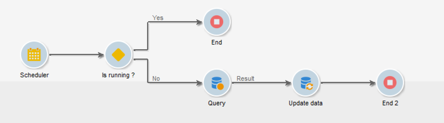
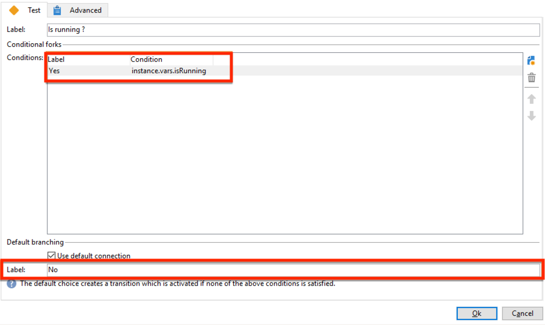
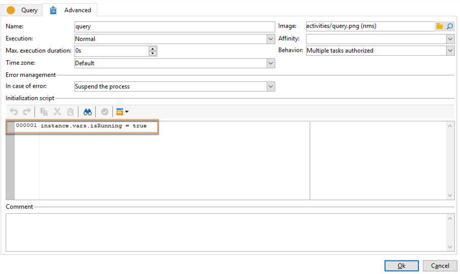
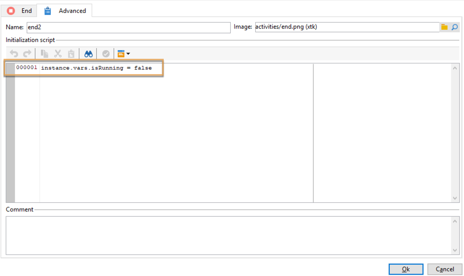

# 協調資料更新{#coordinating-data-updates}

此使用案例詳細說明如何建立工作流程，以便您在使用工作流程的多個執行時管理伴隨的更新。

目的是在執行另一個更新作業之前，檢查更新流程是否已結束。 為此，我們將設定一個執行個體變數，並讓工作流程測試執行個體是否正在執行，以決定是否繼續執行工作流程並執行更新。

此工作流程由以下部分組成：

* 以特定頻率執行工作流程的&#x200B;**排程器**&#x200B;活動。
* **Test**&#x200B;活動，檢查工作流程是否已執行。
* **查詢**&#x200B;和&#x200B;**更新資料**&#x200B;活動（如果工作流程尚未執行），接著會執行&#x200B;**結束**&#x200B;活動，將工作流程執行個體變數重新初始化為false。
* 工作流程已在執行中的&#x200B;**End**&#x200B;活動。

若要建置工作流程，請遵循下列步驟：

1. 新增&#x200B;**排程器**&#x200B;活動，然後根據您的需求設定其頻率。
1. 新增&#x200B;**Test**&#x200B;活動以檢查工作流程是否已執行，然後如下所示設定。

   >[!NOTE]
   >
   >&quot;isRunning&quot;是我們針對此範例選擇的執行個體變數名稱。 這不是內建變數。

   

1. 將&#x200B;**End**&#x200B;活動新增至&#x200B;**No**&#x200B;分支。 如此一來，如果工作流程已執行，則不會執行任何動作。
1. 將所需的活動新增至&#x200B;**是**&#x200B;分支。 在我們的案例中，**查詢**&#x200B;和&#x200B;**更新資料**&#x200B;活動。
1. 開啟第一個活動，然後在&#x200B;**[!UICONTROL Advanced]**&#x200B;索引標籤中新增&#x200B;**instance.vars.isRunning = true**&#x200B;命令。 如此一來，執行個體變數就會設定為執行中。

   

1. 在&#x200B;**[!UICONTROL Yes]**&#x200B;分叉的結尾新增&#x200B;**End**&#x200B;活動，然後在&#x200B;**[!UICONTROL Advanced]**&#x200B;索引標籤中新增&#x200B;**instance.vars.isRunning = false**&#x200B;命令。

   如此一來，只要工作流程仍在執行中，就不會執行任何動作。

   

**相關主題：**

* [防止同時執行多個專案](monitor-workflow-execution.md#preventing-simultaneous-multiple-executions)
* [更新資料活動](update-data.md)
