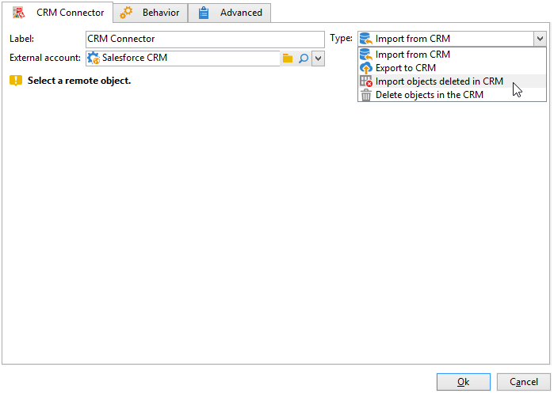
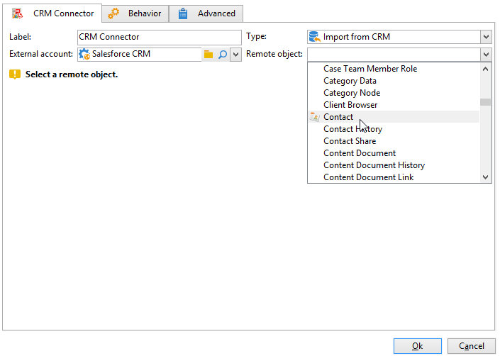

# CRM 連結器{#crm-connector}

**CRM聯結器**&#x200B;活動可讓您設定Adobe Campaign與CRM系統之間的資料同步。

使用此活動，您可以：

* 從CRM匯入
* 匯出為 CRM
* 匯入CRM中刪除的物件
* 刪除 CRM 中的物件

Select符合您要設定同步之CRM的外部帳戶，然後選取要同步的物件（帳戶、商機、聯絡人等）。

如需Adobe Campaign中CRM聯結器的詳細資訊，請參閱[本節](https://experienceleague.adobe.com/docs/campaign/campaign-v8/connect/ac-crm/crm.html){target="_blank"}。
