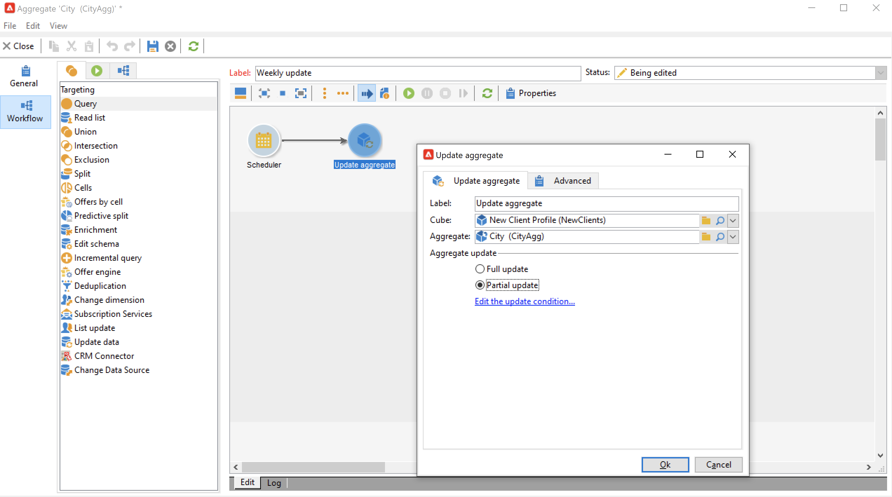
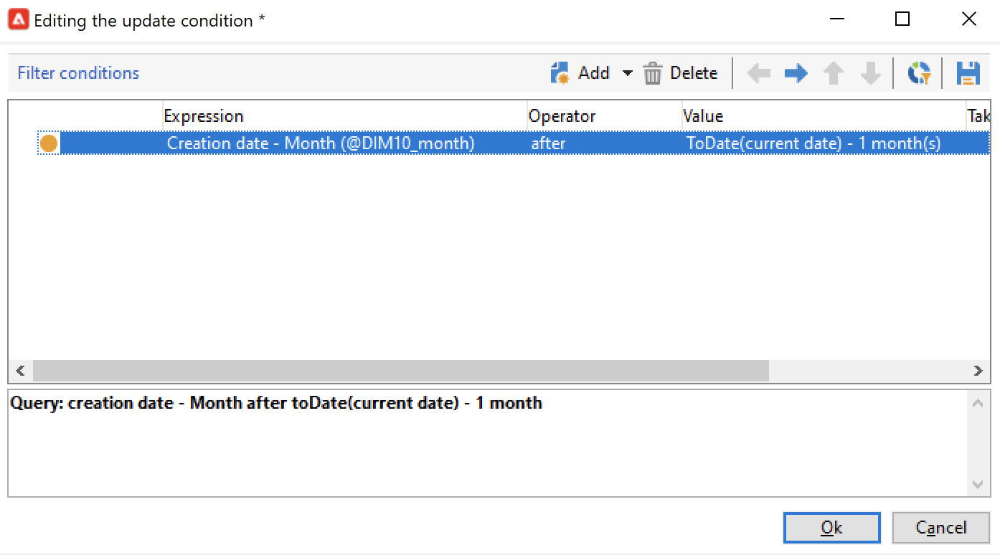

# 更新彙總{#update-aggregate}

[多維度資料集](../../v8/reporting/gs-cubes.md)中定義用於報告的彙總可隨特定活動更新。 設定彙總時可使用&#x200B;**[!UICONTROL Workflow]**&#x200B;標籤。

深入瞭解[立方結構中彙總](../../v8/reporting/customize-cubes.md#calculate-and-use-aggregates)的立方結構和彙總。

若要更新彙總，請編輯&#x200B;**[!UICONTROL Update aggregate]**&#x200B;活動並選取要更新的Cube和彙總。

您可以設定&#x200B;**完整更新**&#x200B;或&#x200B;**部分更新**。

依預設，每次計算期間都會執行完整更新。 若要啟用部分更新，請選取選項並定義更新條件。

良好的作法是新增&#x200B;**[!UICONTROL Scheduler]**&#x200B;活動以設定計算更新的頻率。
