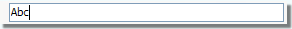

# 編輯

文字輸入的控制項。

## 屬性

**backColor — 字串**&#x200B;背景顏色（btnshadow，白色）。

**邊框 — 字串**&#x200B;變更控制項輪廓樣式（實線、雙線、內縮、外凸、無）。

**font-size - integer**&#x200B;變更字型大小。

**img — 字串**&#x200B;相關影像。

**標籤 — 字串**&#x200B;關聯的標籤。

**lineCount - string**&#x200B;要在編輯模式中顯示的行數。

**nolabel — 布林值**&#x200B;隱藏關聯的標籤。

**noTransaction — 布林值**&#x200B;停用交易模式。

**readOnly — 布林值**&#x200B;強制控制項為唯讀。

**必要 — 布林值**&#x200B;欄位是必要的。
