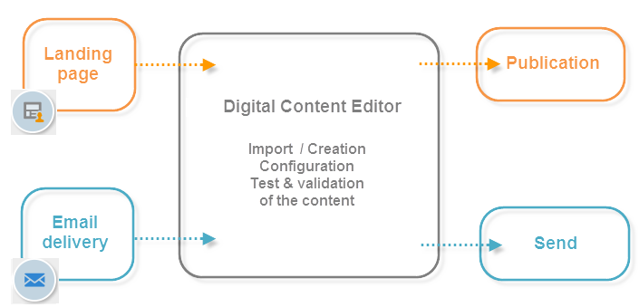

# 開始使用Campaign HTML編輯器{#about-campaign-html-editor}

>[!NOTE]
>
>針對最常見的使用案例，請在Campaign網頁使用者介面中建立您的登入頁面，以便您輕鬆設計及發佈。 如本節所述，在使用者端主控台中建立的登入頁面可提供更多設定，並涵蓋更進階的使用案例。
>
>[進一步瞭解Campaign網頁使用者介面的登入頁面](https://experienceleague.adobe.com/zh-hant/docs/campaign-web/v8/landing-pages/get-started-lp){target="_blank"}

**數位內容編輯器(DCE)**&#x200B;是HTML內容編輯器，可讓您在Adobe Campaign中輕鬆建立HTML格式的內容和範本。

使用數位內容編輯器，您可以插入並格式化頁面元素，並將資料庫欄位與HTML頁面的元素對應。 為Web應用程式建立頁面，或根據DCE範本建立傳遞時，可使用此編輯器。

>[!NOTE]
>
>如果您需要新增伺服器端JavaScript程式碼，請使用個人化區塊。 請參閱[Campaign v8檔案](https://experienceleague.adobe.com/docs/campaign/campaign-v8/send/personalize/personalization-blocks.html?lang=zh-Hant){target="_blank"}。

>[!CAUTION]
>
>所有外部資源都需要以HTTPS URL參照。

## 使用數位內容編輯器的關鍵步驟 {#content-editor-general-operation}

本節提供在Web應用程式和傳遞設計的內容中，編輯和上傳使用DCE編輯之內容的關鍵步驟。

一般操作如下：

若要建立簡單的&#x200B;**網頁應用程式**，您需要：

1. 建立Web應用程式 — [深入瞭解](creating-a-landing-page.md)
1. 選取現有內容或從標準範本建立內容 — [深入瞭解](template-management.md)
1. 編輯及設定內容 — [深入瞭解](editing-content.md)
1. 發佈Web應用程式 — [深入瞭解](creating-a-landing-page.md#step-3---publishing-content)

>[!NOTE]
>
>在[此區段](creating-a-landing-page.md)中有網頁應用程式內容中的完整實作範例。

若要建立&#x200B;**電子郵件傳遞**，您需要：

1. 從DCE範本建立傳遞 — [深入瞭解](use-case-creating-an-email-delivery.md)
1. 選取現有內容或從[標準範本](template-management.md)建立內容
1. 編輯和設定線上內容
1. 傳送傳遞 — 在[Campaign v8檔案](https://experienceleague.adobe.com/docs/campaign/campaign-v8/send/create-message.html?lang=zh-Hant){target="_blank"}中瞭解更多

>[!NOTE]
>
>[此使用案例](use-case-creating-an-email-delivery.md)中有電子郵件傳遞內容中的完整實作範例。
