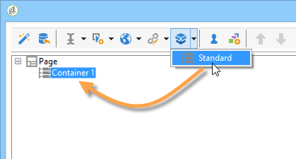
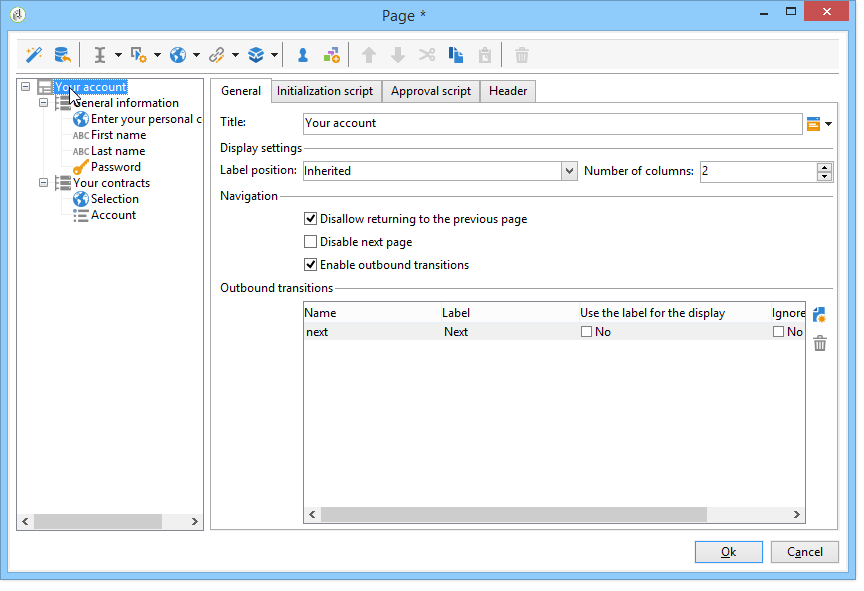
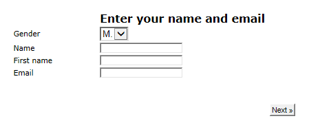
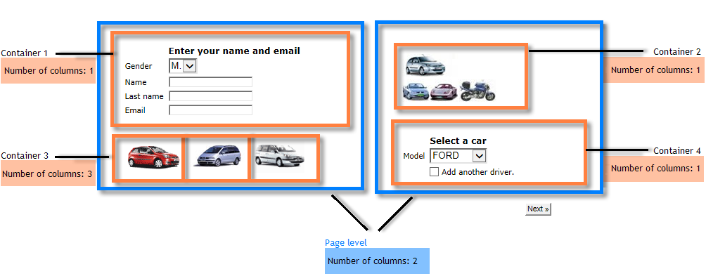

# 定義網路表單版面{#defining-web-forms-layout}

## 建立容器 {#creating-containers}

容器可讓您合併頁面的欄位，設定其版面並組織頁面中的元素。

對於表單的每個頁面，容器都是透過工具列的&#x200B;**[!UICONTROL Containers]**&#x200B;按鈕建立的。

使用容器將頁面的元素分組，而不在最終轉譯新增標籤。 元素會分組到容器子樹狀結構中。 標準容器可讓您管理版面。

例如：

標籤的位置會套用至階層中置於容器下方的元素。 如有必要，可針對每個元素將其多載。 新增或移除欄以變更版面。 請參閱[定位頁面](#positioning-the-fields-on-the-page)上的欄位。

在上述範例中，演算方式如下：

## 定位頁面上的欄位 {#positioning-the-fields-on-the-page}

網頁表單的版面配置是在每個容器中逐頁定義，必要時可多載。

頁面會劃分為欄：每個頁面都包含特定數量的欄。 頁面的每個欄位都佔用&#x200B;**n**&#x200B;個儲存格。 容器也會佔據特定數量的欄，而且容器包含的欄位會佔據特定數量的儲存格。

依預設，頁面會建置在單一欄上，而每個元素會佔用一個儲存格。 這表示欄位會一個顯示在另一個欄位下，每個欄位佔據一整行，如下所示：

在下列範例中，已保留預設設定。 此頁面佔據一欄，其中包含四個容器。

每個容器佔據一欄，每個元素佔據一個儲存格：

演算方式如下：

您可以調整顯示引數以取得下列演算：

在上述彩現範例中，每個輸入欄位、標題和影像在容器的欄中佔據一個儲存格。

您可以修改每個容器中的格式。 在我們的範例中，您可以將容器4的內容分配至兩欄，並分配元素。

標題和清單各佔一個儲存格（因此是容器的整行），而核取方塊會延伸至兩個儲存格。 根據欄位型別，歸因至輸入欄位的儲存格數定義於&#x200B;**[!UICONTROL General]**&#x200B;索引標籤或&#x200B;**[!UICONTROL Advanced]**&#x200B;索引標籤中：

![核取方塊元素的進階索引標籤，在[顯示]設定下的[儲存格數目]設為2](assets/s_ncs_admin_survey_container_ex2.png)

## 定義標籤位置 {#defining-the-position-of-labels}

您可以在表單中定義欄位和標籤的對齊方式。

依預設，欄位和頁面其他內容的顯示引數繼承自表單的一般設定、頁面的設定或父容器的設定（如果存在）。

整個表單的全域顯示引數是在表單屬性方塊中指定的。 **[!UICONTROL Rendering]**&#x200B;標籤可讓您選取標籤的位置。

透過&#x200B;**[!UICONTROL Advanced]**&#x200B;索引標籤，可針對每個頁面、每個容器和每個欄位多載此位置。

支援下列對齊：

* 繼承：對齊方式繼承自父元素（預設值），即父容器（如有）或其他頁面。
* 左/右：標籤位於欄位的右側或左側，
* 上/下：標籤位於欄位上方或下方，
* 隱藏：不顯示標籤。
