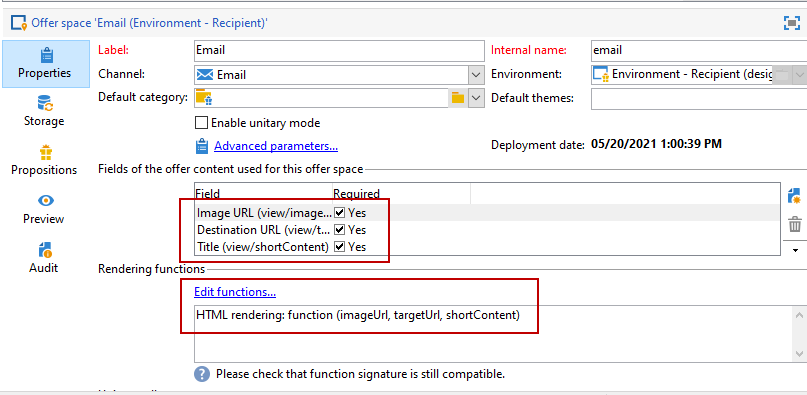
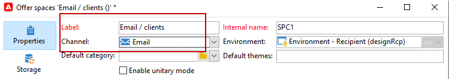
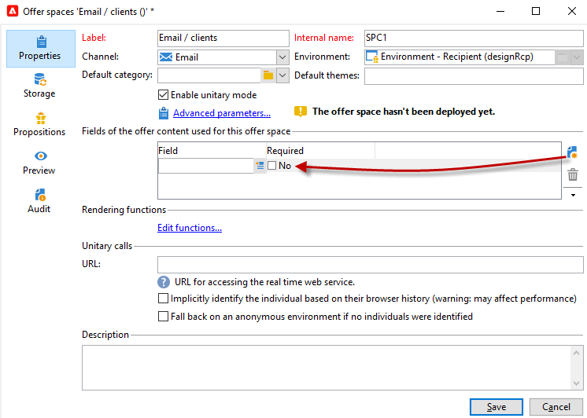
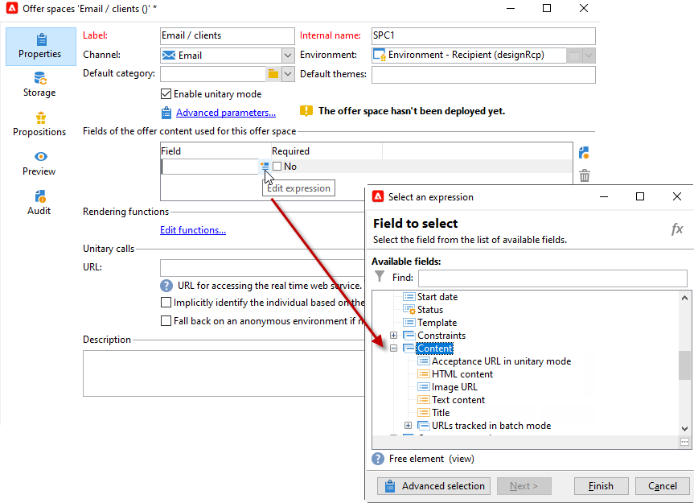
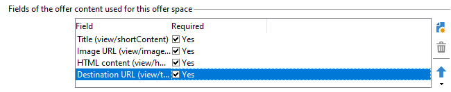
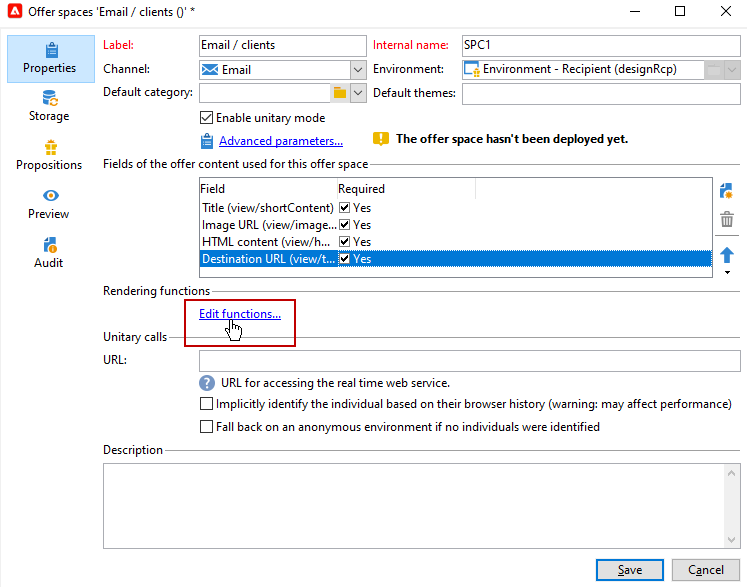
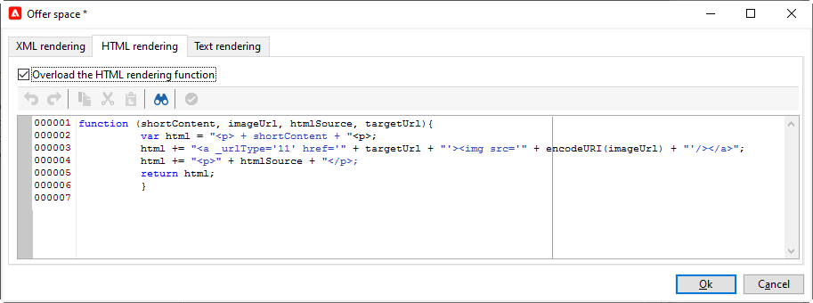
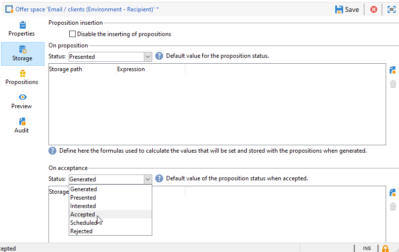
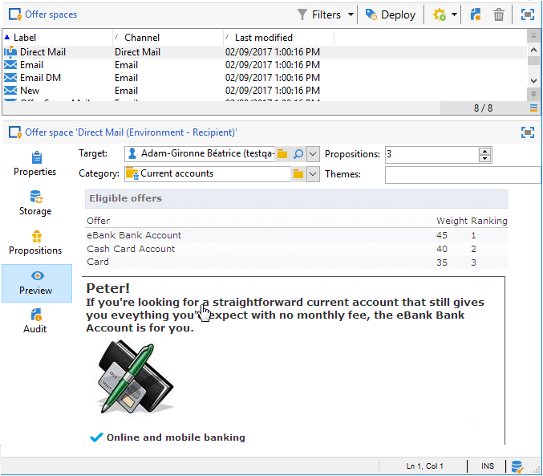
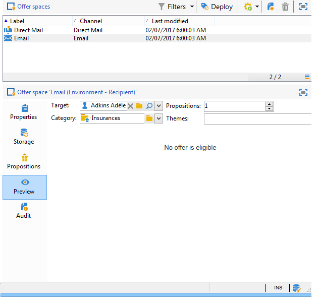

# 建立產品建議空間{#creating-offer-spaces}

優惠方案目錄的內容是在優惠方案空間中設定。 依預設，內容可以包含以下欄位： **[!UICONTROL Title]**、**[!UICONTROL Destination URL]**、**[!UICONTROL Image URL]**、**[!UICONTROL HTML content]**&#x200B;和&#x200B;**[!UICONTROL Text content]**。 欄位序列是在選件空間中設定。

作為&#x200B;**技術管理員**，您可以在設計環境中建立優惠方案空間。 您必須具備優惠方案空間子資料夾的存取權。 建立後，這些優惠方案空間會在優惠方案核准期間自動複製到即時環境中。

HTML呈現會透過呈現函式建立。 轉譯函式中定義的欄位順序必須與內容中設定的順序相同。



若要建立新的優惠方案空間，請遵循下列步驟：

1. 在選件空間清單中，按一下&#x200B;**[!UICONTROL New]**。

   ![反白顯示[新增]按鈕且已選取電子郵件優惠方案空間的優惠方案空間清單](assets/offer_space_create_001.png)

1. 選取您要使用的管道，並變更優惠方案空間的標籤。

   

1. 核取 **[!UICONTROL Enable unitary mode]** 選項。

1. 前往&#x200B;**[!UICONTROL Content field]**&#x200B;視窗並按一下&#x200B;**[!UICONTROL Add]**。

   

1. 移至&#x200B;**[!UICONTROL Content]**&#x200B;節點，並依下列順序選取欄位： **[!UICONTROL Title]**、**[!UICONTROL Image URL]**、**[!UICONTROL HTML content]**、**[!UICONTROL Destination URL]**。

   

1. 核取&#x200B;**[!UICONTROL Required]**&#x200B;選項，讓每個欄位成為必要欄位。

   >[!NOTE]
   >
   >此選項用於預覽，如果選件中缺少其中一個必填欄位，會在發佈時讓選件空格無效。 但是，如果優惠方案空間中已上線，則不會考慮這些條件。

   

1. 按一下&#x200B;**[!UICONTROL Edit functions]**&#x200B;以建立演算函式。

   這些函式用於在優惠方案空間上產生優惠方案宣告。 有幾種可能的格式：HTML或文字。

   **注意** - XML格式僅限於此版本產品中無法使用的輸入互動。 [了解更多](../start/v7-to-v8.md#gs-unavailable-features)

   _

1. 移至&#x200B;**[!UICONTROL HTML rendering]**&#x200B;標籤並選取&#x200B;**[!UICONTROL Overload the HTML rendering function]**。
1. 插入您的演算函式。

   

## 優惠方案主張狀態 {#offer-proposition-statuses}

優惠方案主張狀態會依與目標群體的互動而有所不同。 「促銷活動互動」模組隨附一組值，可在優惠方案主張的整個生命週期中套用這些值。 您需要設定平台，以便在建立及接受優惠方案主張時變更狀態。

>[!NOTE]
>
>狀態更新是&#x200B;**非同步**&#x200B;程式。 追蹤工作流程會每小時觸發一次。

### 優惠狀態清單 {#status-list}

可用的優惠方案狀態為：

* **[!UICONTROL Accepted]**
* **[!UICONTROL Scheduled]**
* **[!UICONTROL Generated]**
* **[!UICONTROL Interested]**
* **[!UICONTROL Presented]**
* **[!UICONTROL Rejected]**

預設不會套用這些值：必須加以設定。

>[!NOTE]
>
>如果優惠連結到狀態為「已傳送」的傳遞，優惠方案主張的狀態會自動變更為「已呈現」。

### 建立主張時的優惠方案狀態 {#configuring-the-status-when-the-proposition-is-created}

當優惠方案主張為&#x200B;**已建立**&#x200B;時，其狀態會更新。

在&#x200B;**[!UICONTROL Design]**&#x200B;環境中，根據您要在優惠方案報表中顯示的資訊，針對每個優惠方案空間，設定建立主張時要套用的狀態。

要執行此操作，請遵循下列步驟：

1. 前往所需空間的&#x200B;**[!UICONTROL Storage]**&#x200B;標籤。
1. 選取建立主張時套用的狀態。

   ![儲存索引標籤，其中的[在上]主張狀態清單已開啟，且正在選取[呈現]狀態](assets/offer_update_status_001.png)

### 接受主張時的優惠狀態 {#configuring-the-status-when-the-proposition-is-accepted}

一旦優惠方案主張已&#x200B;**接受**，請使用預設提供的其中一個值來設定主張的新狀態。 當收件者按一下優惠方案中的連結時，就會套用更新。

要執行此操作，請遵循下列步驟：

1. 前往所需空間的&#x200B;**[!UICONTROL Storage]**&#x200B;標籤。
1. 選取您要在主張被接受時套用的狀態。

   


**傳入互動**

**[!UICONTROL Storage]**&#x200B;索引標籤可讓您只定義&#x200B;**建議**&#x200B;和&#x200B;**接受**&#x200B;優惠方案主張的狀態。 針對傳入互動，應直接在呼叫優惠方案引擎的URL中指定優惠方案主張的狀態，而非透過介面。 如此一來，您將能夠指定在其他情況下要套用的狀態，例如在優惠方案主張被拒絕時。

```xml
<BASE_URL>?a=UpdateStatus&p=<PRIMARY_KEY_OF_THE_PROPOSITION>&st=<NEW_STATUS_OF_THE_PROPOSITION>&r=<REDIRECT_URL>
```

例如，符合&#x200B;**Neobank**&#x200B;網站上顯示之&#x200B;**家庭保險**&#x200B;優惠方案的主張（識別碼&#x200B;**40004**）包含下列URL：

```xml
<BASE_URL>?a=UpdateStatus&p=<40004>&st=<3>&r=<"http://www.neobank.com/insurance/subscribe.html">
```

只要訪客按一下選件（因此是URL），就會將&#x200B;**[!UICONTROL Accepted]**&#x200B;狀態（值&#x200B;**3**）套用至主張，且訪客會重新導向至&#x200B;**Neobank**&#x200B;網站的新頁面，以取得保險合約。

>[!NOTE]
>
>如果您想在URL中指定其他狀態（例如，如果優惠方案主張被拒絕），請使用與所需狀態對應的值。 範例： **[!UICONTROL Rejected]** = &quot;5&quot;、**[!UICONTROL Presented]** = &quot;1&quot;等。
>
>可以在&#x200B;**[!UICONTROL Offer propositions (nms)]**&#x200B;資料結構描述中擷取狀態及其值。 如需詳細資訊，請參閱[在Campaign](../dev/create-schema.md)中建立新的結構描述。

**傳出互動**

當傳遞包含連結時，您可以自動將&#x200B;**[!UICONTROL Interested]**&#x200B;狀態套用至優惠方案主張。 只需將&#x200B;**_urlType=&quot;11&quot;**&#x200B;值新增至連結即可：

```xml
<a _urlType="11" href="<DEST_URL>">Link inserted into the delivery</a>
```

## 每個空間的優惠預覽 {#offer-preview-per-space}

在&#x200B;**[!UICONTROL Preview]**&#x200B;索引標籤中，您可以透過選取的方法檢視收件者符合資格的優惠方案。 在下列範例中，收件者有資格透過郵件取得三個優惠方案書。



如果收件者不符合任何優惠方案的資格，便會在預覽中顯示。




當上下文限製為空格時，預覽可以忽略上下文。 當互動結構描述已延伸，以使用傳入頻道新增空間中所參照的欄位時，就會發生這種情況。

如需詳細資訊，請參閱[擴充功能範例](extension-example.md)中的範例。