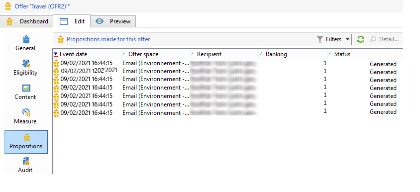
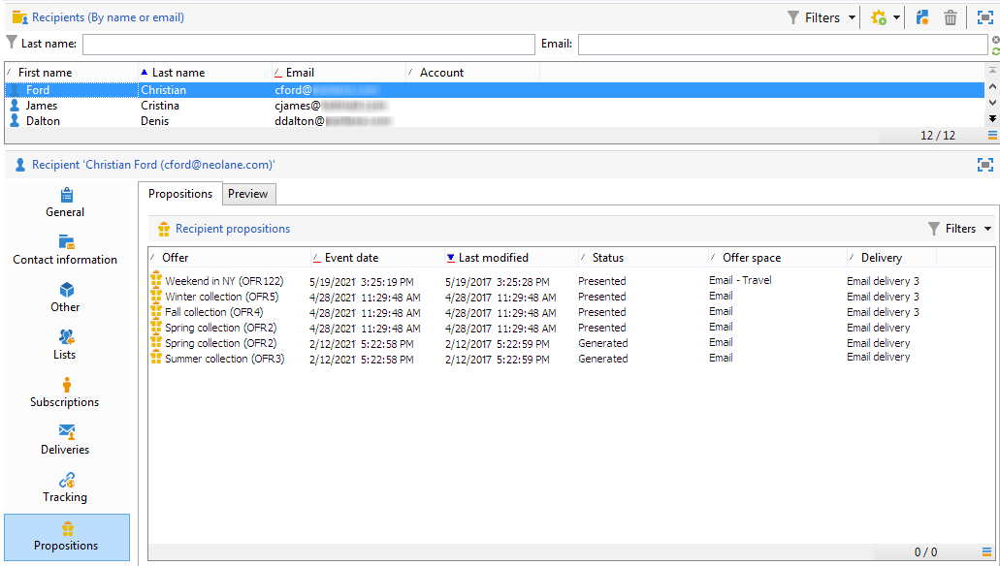
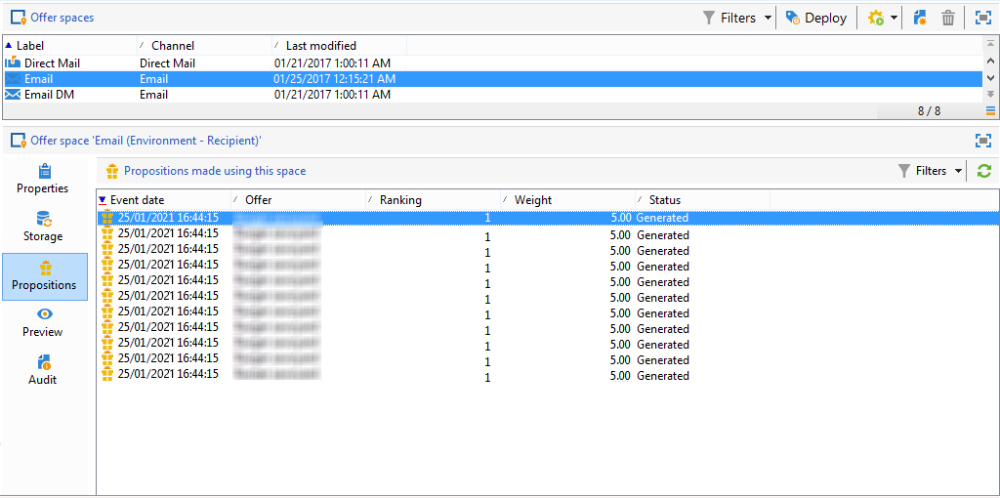
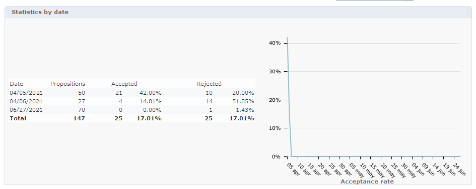
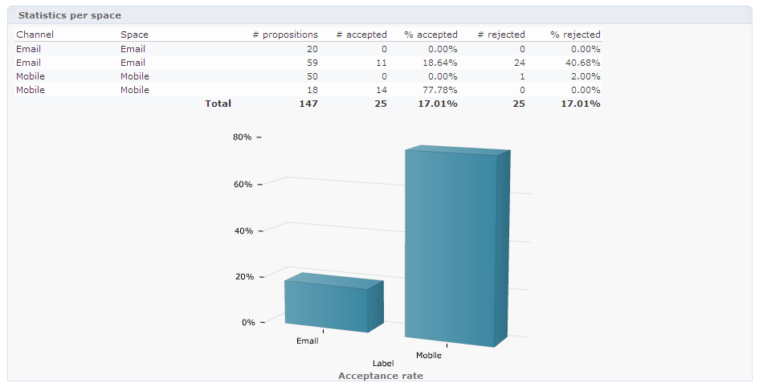
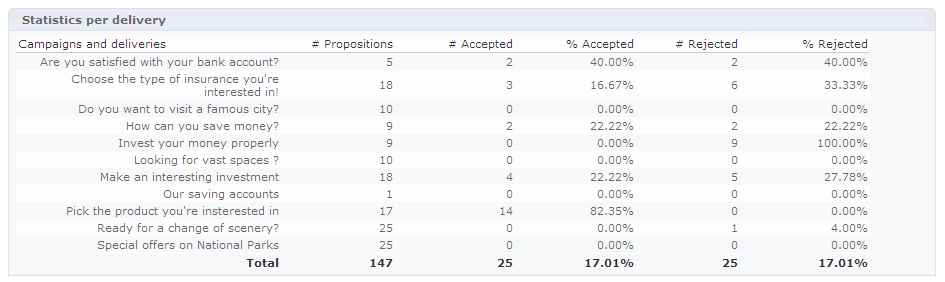

# 即時互動記錄和報表

>[!NOTE]
>
>這些功能只會線上上顯示，而且只有&#x200B;**傳遞管理員**&#x200B;可以看到。

## 產品建議提議歷史記錄{#offer-proposition-history}

提出優惠方案主張後，即可檢視簡報歷史記錄。

* 在選件層級的&#x200B;**[!UICONTROL Edit]**&#x200B;索引標籤中，按一下&#x200B;**[!UICONTROL Propositions]**。

  

* 在收件者的設定檔中，按一下「**[!UICONTROL Propositions]**」標籤。

  收件者設定檔的

* 在優惠方案空間層級，按一下&#x200B;**[!UICONTROL Propositions]**&#x200B;標籤。

  優惠方案空間的

## 產品建議分析報告{#offer-analysis-report}

**[!UICONTROL Offer analysis]**&#x200B;報告提供您接受或拒絕建議數目的概觀。

統計資料會根據三個條件排序：

* 依日期：

  

* 依空間：

  

* 依傳遞：

  

您可以根據報表上方區段中提供的各種條件來篩選資料。 選取想要的條件後，按一下&#x200B;**[!UICONTROL Refresh]**&#x200B;連結以將其套用至報表。
