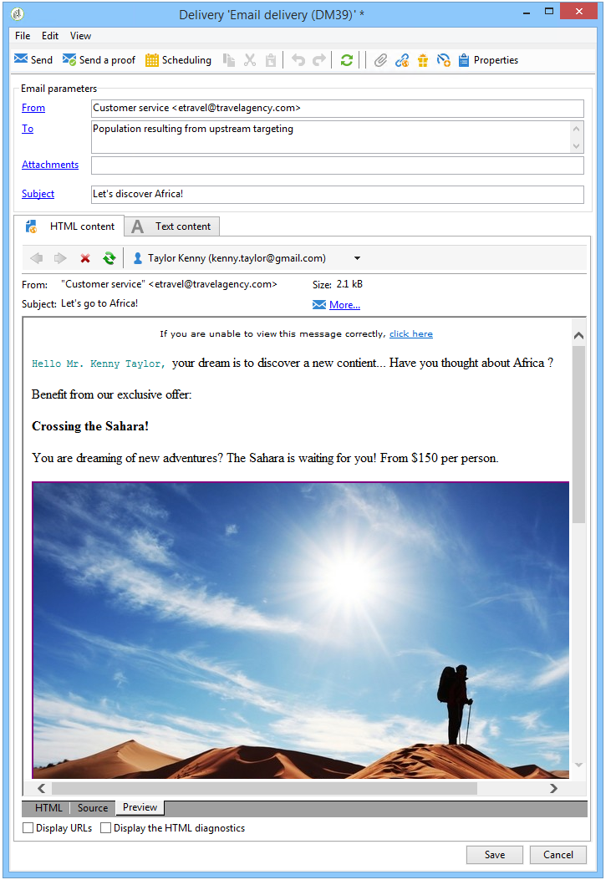
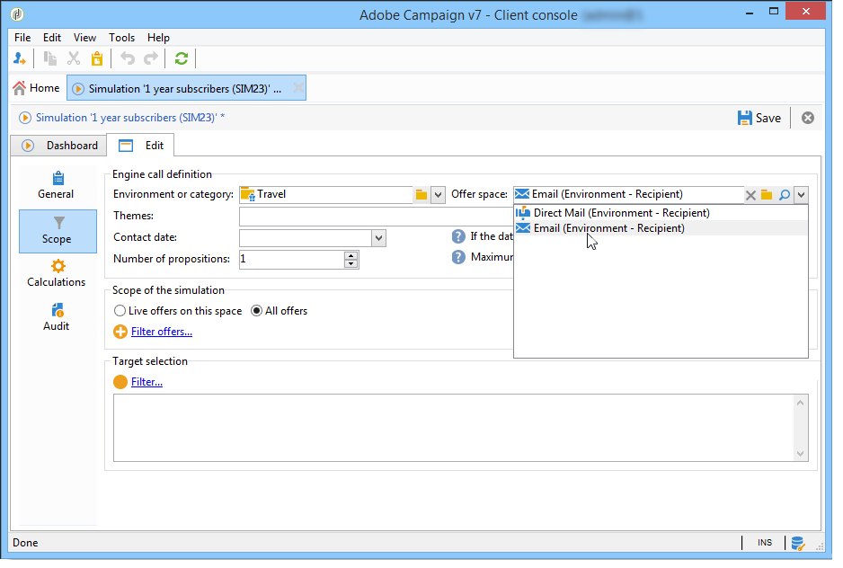
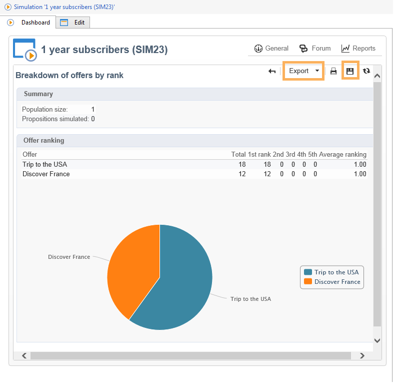

# 傳出頻道上的產品建議{#offers-on-an-outbound-channel}

## 電子郵件選件傳遞 {#email-offer-delivery}

在我們的資料庫中，有一個前往非洲的旅行優惠方案類別。 已設定每個優惠方案的適用性、內容與表示方式。 我們現在想要建立行銷活動，透過電子郵件呈現我們的優惠方案。

1. 建立行銷活動和目標定位工作流程。

   

1. 編輯電子郵件傳遞並按一下&#x200B;**[!UICONTROL Offers]**&#x200B;圖示。

   

1. 為您的優惠方案環境選擇符合假日的電子郵件空間。

   

1. 選擇包含非洲旅行優惠方案的類別。

   

1. 將傳送中的選件數量設定為兩個。

   

1. 關閉Offer Management視窗，並建立您的傳遞內容。

   

1. 使用功能表插入第一個優惠方案主張，並選擇HTML演算函式。

   

1. 插入第二個優惠方案主張。

   

1. 按一下&#x200B;**[!UICONTROL Preview]**&#x200B;以預覽傳遞中的優惠，然後選取收件者以預覽他們將會收到的優惠。

   

1. 儲存您的傳送並啟動目標定位工作流程。
1. 開啟您的傳遞，然後按一下傳遞的&#x200B;**[!UICONTROL Audit]**&#x200B;標籤：您可以看到優惠方案引擎已選取要從目錄中的各種優惠方案提出的主張。

   

## 執行優惠方案模擬 {#perform-an-offer-simulation}

1. 在&#x200B;**[!UICONTROL Profiles and Targets]**&#x200B;索引標籤中，按一下&#x200B;**[!UICONTROL Simulations]**&#x200B;連結，然後按一下&#x200B;**[!UICONTROL Create]**&#x200B;按鈕。

   ![使用[建立]按鈕的模擬清單，開啟包含範本、標籤和資料夾的[新增優惠方案模擬]對話方塊](assets/offer_simulation_001.png)

1. 選擇標籤，並視需要指定執行設定。

   

1. 儲存模擬。 然後會在新標籤中開啟。

   ![具有[編輯]索引標籤和[開始]模擬按鈕之1年訂閱者的模擬儀表板](assets/offer_simulation_example_003.png)

1. 按一下「**[!UICONTROL Edit]**」標籤，然後按&#x200B;**[!UICONTROL Scope]**。

   

1. 選擇要模擬優惠方案的類別。

   

1. 選擇要用於模擬的優惠方案空間。

   

1. 輸入有效日期。 您至少必須輸入開始日期。 這可讓優惠方案引擎篩選優惠方案，並選擇在指定日期有效的優惠方案。
1. 如有必要，請指定一或多個主題，將選件數量限製為設定中包含此關鍵字的選件數量。

   在我們的範例中，**旅遊**&#x200B;類別包含兩個子類別和兩個不同的主題。 我們想要針對具有&#x200B;**客戶>1年**&#x200B;主題的優惠方案執行模擬。

   ![在旅行類別的[主題]欄位中輸入客戶> 1年主題的範圍區段](assets/offer_simulation_example_007.png)

1. 選擇您要鎖定的收件者。

   

1. 設定要傳送給每個收件者的優惠方案數量。

   在我們的範例中，優惠方案引擎會為每個收件者選擇權重最高的3個優惠方案。

   

1. 儲存您的設定，然後按一下「**[!UICONTROL Dashboard]**」標籤中的「**[!UICONTROL Start]**」以執行模擬。

   ![儀表板開始模擬對話方塊要求確認，並反白顯示[確定]按鈕](assets/offer_simulation_example_010.png)

1. 模擬完成後，請參閱&#x200B;**[!UICONTROL Results]**&#x200B;以取得每個選件的主張詳細劃分。

   在我們的範例中，優惠方案引擎是根據3個主張進行優惠方案劃分。

   

1. 顯示&#x200B;**[!UICONTROL Breakdown of offers by rank]**&#x200B;以檢視優惠方案引擎所選取的優惠方案清單。

   

1. 如有需要，您可以按一下&#x200B;**[!UICONTROL Start simulation]**&#x200B;來變更範圍設定並重新執行模擬。

   ![儀表板開始模擬對話方塊要求確認，並反白顯示[確定]按鈕](assets/offer_simulation_example_010.png)

1. 若要儲存模擬資料，請使用報表中可用的歷史記錄或匯出函式。

   
