# 使用 cubes 來探索資料{#use-cubes-to-create-reports}

使用立方結構來建立報表，以及識別及選取資料庫中的資料。 您可以：

* 根據立方體建立報告。 [了解更多資訊](#explore-the-data-in-a-report)。
* 收集資料庫中的資料，並將其分組到清單中，例如識別及建立目標及傳遞。 [了解更多資訊](#build-a-target-population)。
* 在報表中插入樞紐分析表，參照其中現有的立方結構。 [了解更多資訊](#insert-a-pivot-table-into-a-report)。

## 探索報表中的資料 {#explore-the-data-in-a-report}

### 步驟1 — 根據立方體建立報表 {#step-1---create-a-report-based-on-a-cube}

設定[Cube](cube-indicators.md)後，便可作為建立新報告的範本。

若要根據現有的立方結構建立報告，請遵循下列步驟：

1. 按一下&#x200B;**[!UICONTROL Reports]**&#x200B;索引標籤的&#x200B;**[!UICONTROL Create]**&#x200B;按鈕，然後選取您剛建立的Cube。

   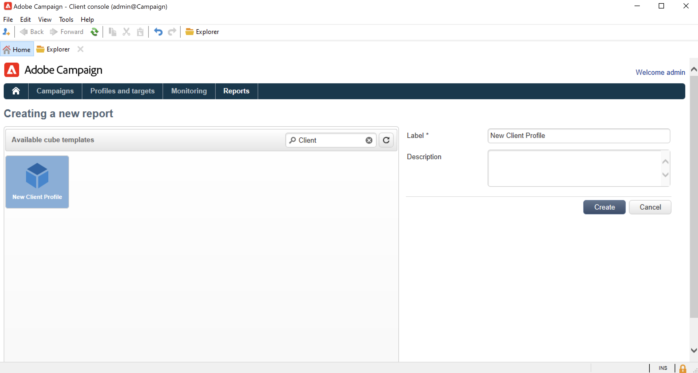

1. 按一下&#x200B;**[!UICONTROL Create]**&#x200B;按鈕以確認：這會將您導向至報告設定和檢視頁面。

   依預設，前兩個可用尺寸以行和欄提供，但表格中不顯示任何值。 若要產生表格，請按一下主圖示：

   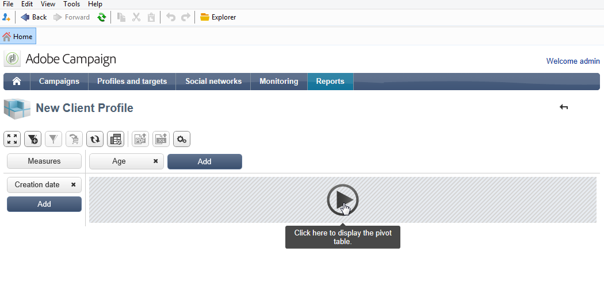

1. 您可以切換尺寸的軸、刪除它們、新增測量等。要執行此操作，請使用適當的圖示。

   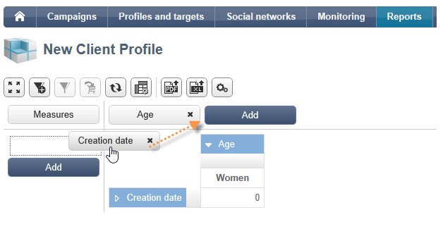

   這些操作詳見下文。

### 步驟2 — 選取行和欄 {#step-2---select-lines-and-columns}

預設顯示會顯示立方結構的前兩個維度（在此例中是年齡和城市）。

每個軸上的&#x200B;**[!UICONTROL Add]**&#x200B;按鈕可讓您新增維度。

在新使用者端設定檔報告的線軸上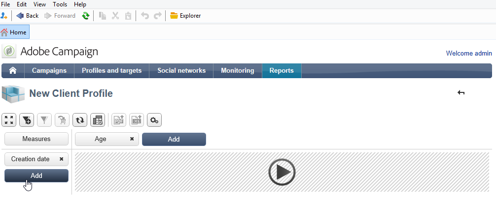

1. 選取要在表格的行和欄中顯示的尺寸。 若要這麼做，請拖放可用的維度。
1. 從清單中選取要新增至表格的維度：
   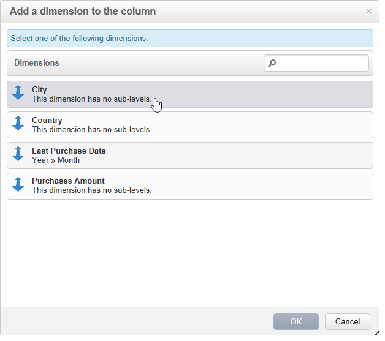

1. 然後選取此尺寸的引數。

   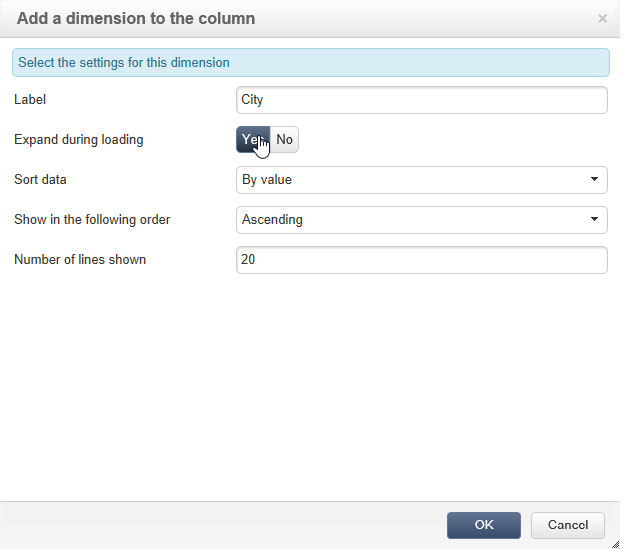

   這些引數取決於所選維度的資料型別。

   例如，日期有數個層級可供使用。 如需詳細資訊，請參閱[顯示量值](customize-cubes.md#display-measures)。

   在這種情況下，可使用下列選項：

   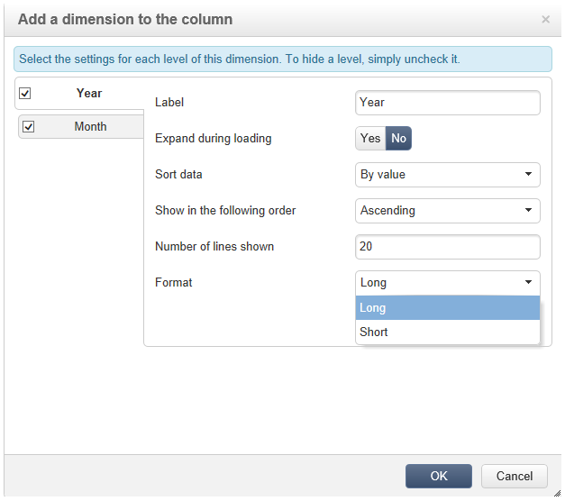

   您可以：

   * 載入時展開資料：預設會在每次更新報表時顯示值（預設值：否）。
   * 在行尾顯示總計：當資料以欄顯示時，附加選項可讓您在行尾顯示總計：在表格中新增欄（預設值：是）。
   * 套用排序：欄的值可依值、標籤或量值（預設值：依值）排序。
   * 以遞增(a-z、0-9)或遞減(z-a、9-0)順序顯示值。
   * 變更載入時顯示的欄數（預設為： 200）。

1. 按一下&#x200B;**[!UICONTROL Ok]**&#x200B;以確認：維度已新增至現有維度。

   表格上方的黃色橫幅顯示您已進行變更：按一下「**[!UICONTROL Save]**」按鈕以儲存變更。

   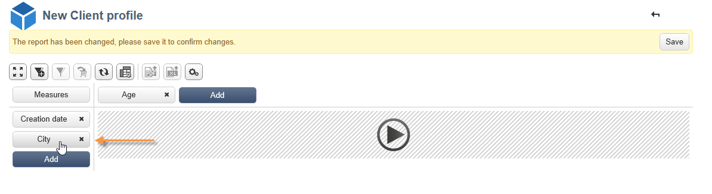

### 步驟3 — 設定要顯示的測量 {#step-3---configure-the-measures-to-display}

定義直線與欄之後，請選取要顯示的測量。 依預設，只顯示一個量值。

若要新增及設定測量，請遵循下列步驟：

1. 按一下 **[!UICONTROL Measures]** 按鈕。

   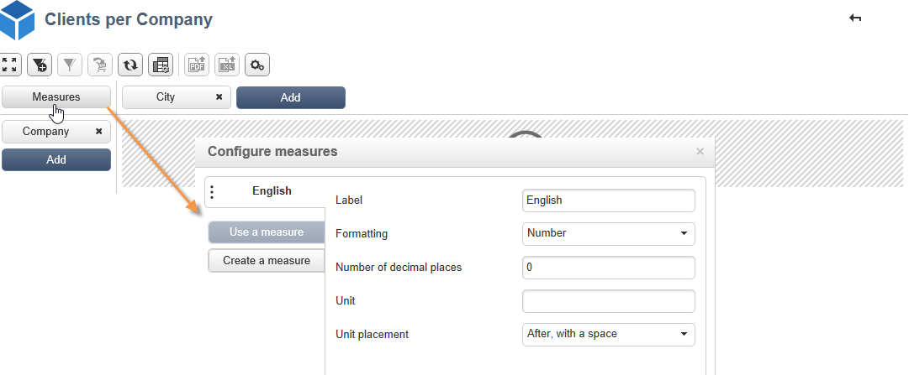

1. 使用&#x200B;**[!UICONTROL Use a measure]**&#x200B;按鈕，選取其中一個現有的測量。

   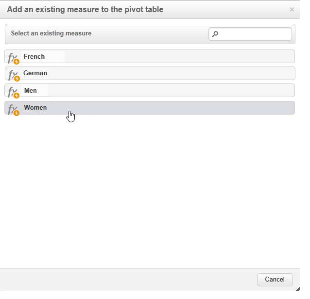

   選擇要顯示的資訊和格式選項。 選項清單視量測型別而定。

   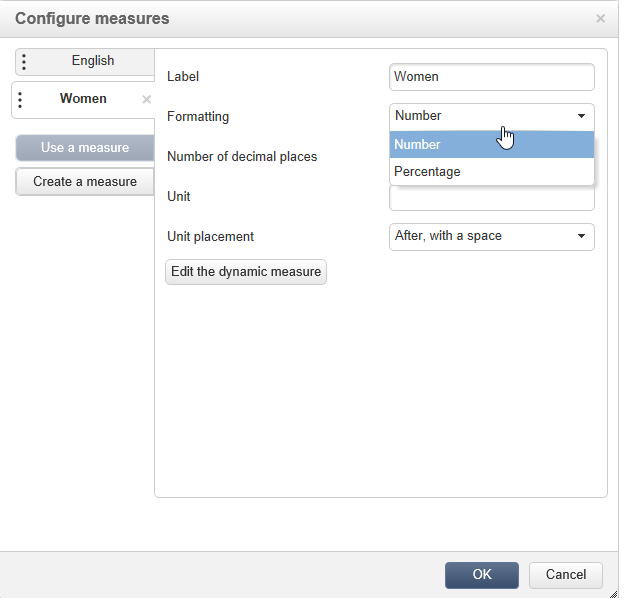

   整體量值設定也可透過標頭中的&#x200B;**[!UICONTROL Edit the configuration of the pivot table]**&#x200B;圖示取得。

   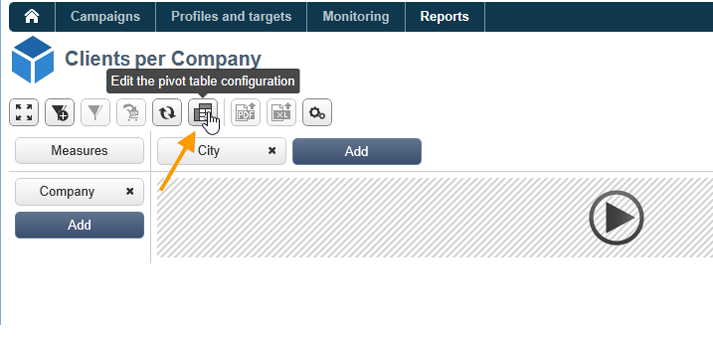

   然後，您可以選擇是否要顯示測量標籤。 [了解更多資訊](customize-cubes.md#configuring-the-display)。

1. 您可以根據現有測量來建置新測量。 若要這麼做，請按一下&#x200B;**[!UICONTROL Create a measure]**&#x200B;並加以設定。

   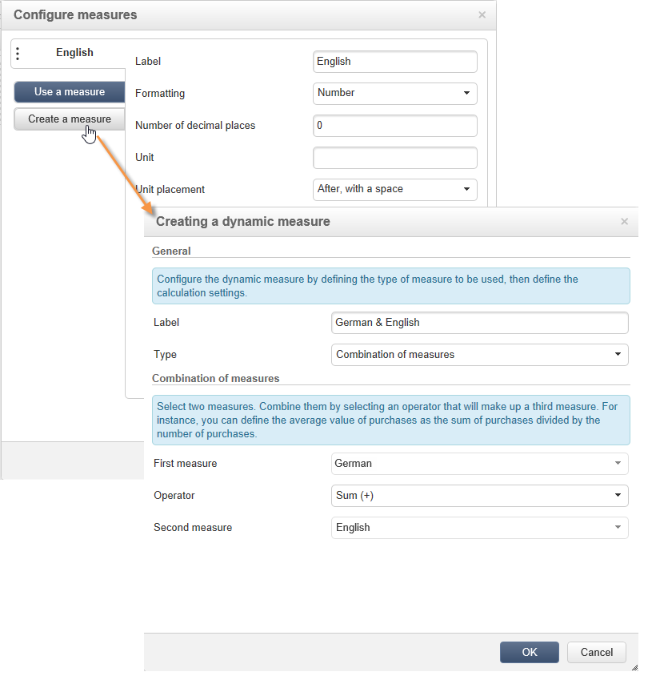

   可用的測量型別如下：

   * 測量的組合：此型別的測量可讓您使用現有的測量來建立新的測量：

     可用的運運算元包括：和、差、乘和速率。

   * 比例：此測量型別可讓您計算針對指定維度測量的記錄數。 您可以根據維度或子維度來計算比例性。
   * 變化：此測量可讓您計算某個層級值的變化。
   * 標準差：此型別的測量可讓您計算每一儲存格群組內與平均值比較的偏差。 例如，您可以比較所有現有區段的購買量。

   建立之後，測量就會新增到報表中。

   ![樞紐分析表顯示[男女]旁的新德文與英文量值，依公司而定](assets/cube-display-new-measure.png)

   建立測量之後，即可編輯並變更其組態。 若要這麼做，請按一下&#x200B;**[!UICONTROL Measures]**&#x200B;按鈕，然後瀏覽至要編輯之量值的索引標籤。

   然後按一下&#x200B;**[!UICONTROL Edit the dynamic measure]**&#x200B;以存取設定功能表。

## 建立目標母體 {#build-a-target-population}

使用立方體建置的報告可讓您從表格收集資料並將其儲存在清單中。

若要將母體分組到清單中，請遵循下列步驟：

1. 按一下包含要收集之母體的儲存格以選取它們，然後按一下&#x200B;**[!UICONTROL Add to cart]**&#x200B;圖示。

   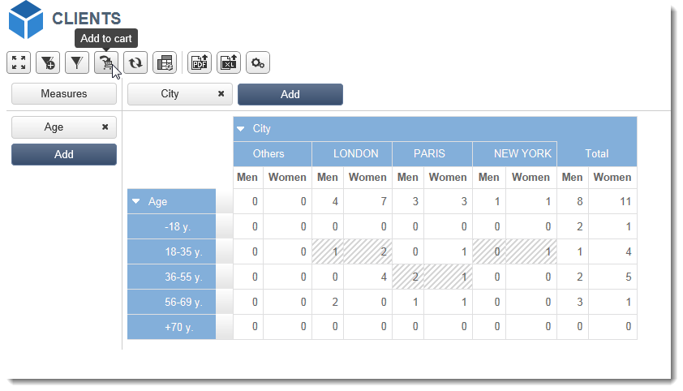

   視需要多次執行此動作，以收集各種設定檔。

1. 在執行匯出之前，按一下&#x200B;**[!UICONTROL Show cart]**&#x200B;按鈕以檢視其內容。

   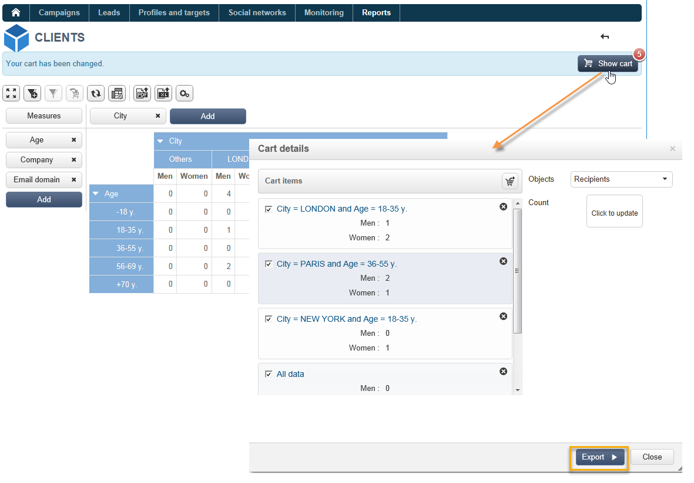

1. 使用&#x200B;**[!UICONTROL Export]**&#x200B;按鈕將購物車中的專案分組到清單中。

   輸入清單名稱，並選取要執行的匯出型別。

   ![匯出購物車1/2對話方塊，其中包含匯出至新清單、標籤、資料夾和匯出型別，以及[開始]按鈕](assets/cube-export-report.png)

   按一下&#x200B;**[!UICONTROL Start]**&#x200B;以執行匯出。

1. 匯出完成後，訊息會確認其執行以及已處理的記錄數。

   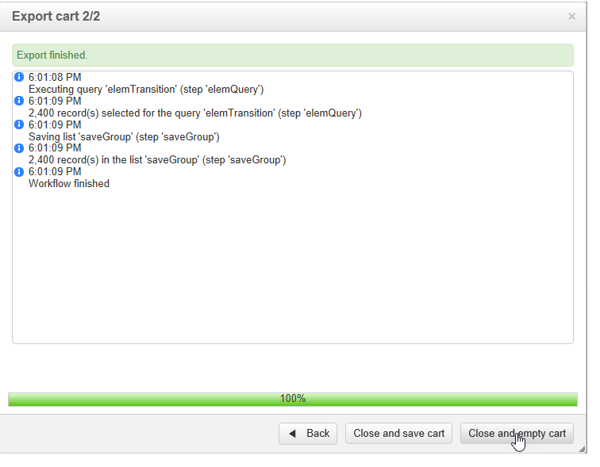

   您可以儲存購物車的內容或將其清空。

   新清單可透過&#x200B;**[!UICONTROL Profiles and targets]**&#x200B;索引標籤取得。

   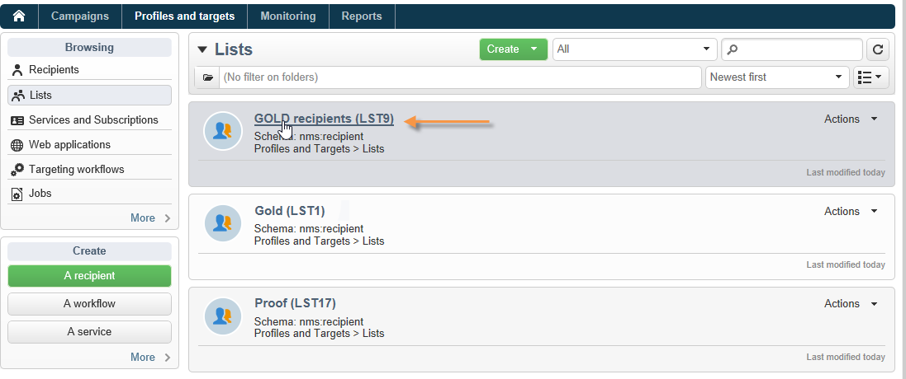

## 在報表中插入樞紐分析表 {#insert-a-pivot-table-into-a-report}

若要建立表格並探索立方結構中的資料，請遵循下列步驟：

1. 建立具有單一頁面的新報表，並在其中插入樞紐分析表。

   ![含有頁面活動的報表編輯器，以及工具列功能表中的[樞紐分析表]選項](assets/cube-insert-in-report.png)

1. 在頁面的&#x200B;**[!UICONTROL Data]**&#x200B;頁簽中，選取要處理其所包含維度的Cube，並顯示計算的計量。

   在Cube欄位中選取新使用者端設定檔Cube的樞紐分析表的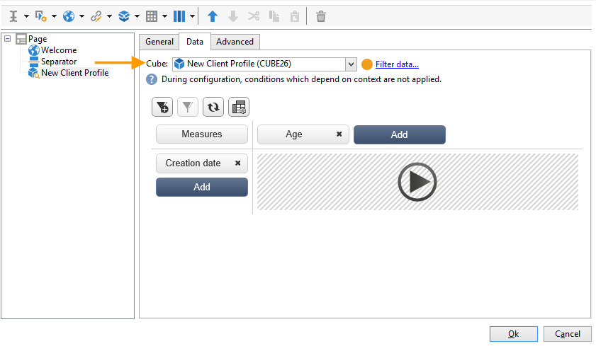

   這可讓您建立要顯示的報表。 如需詳細資訊，請參閱步驟2 - Select行和欄[&#128279;](#step-2---select-lines-and-columns)。
